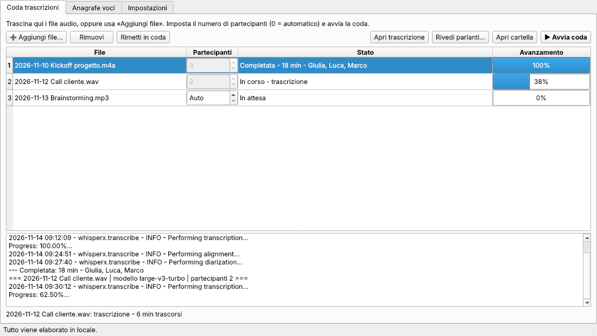

# Trascrittore

**Trascrizione delle riunioni con riconoscimento dei parlanti, tutto in locale.**
*Meeting transcription with speaker recognition, fully local. English summary below.*

Trascrittore è un'app desktop per Windows e macOS costruita su [WhisperX](https://github.com/m-bain/whisperX) e [pyannote.audio](https://github.com/pyannote/pyannote-audio). Trascrive file audio e video, separa le voci e, grazie a un'**anagrafe delle voci**, mette in automatico il nome giusto accanto a ogni intervento.

L'audio non lascia mai il computer: Internet serve solo per installare i pacchetti e scaricare i modelli la prima volta.



## Funzionalità

- **Coda di trascrizioni**: trascini file o cartelle, imposti il numero di partecipanti, la coda lavora da sola e resta salvata anche chiudendo l'app.
- **Anagrafe voci**: un'impronta vocale per persona, ricavata da un breve audio o direttamente da una riunione già trascritta.
- **Revisione parlanti**: correggi i nomi e memorizzi le voci nuove con una spunta.
- **Risultato leggibile**: `nome_nomi.txt` con orario e nome di chi parla, pronto per farne un verbale.
- **Impostazioni**: modello (large-v3, large-v3-turbo, medium, small), lingua, CPU o GPU NVIDIA, parole chiave, soglia di riconoscimento.

```
[00:00:12] Luca: Partiamo dal primo punto...

[00:00:41] Marco: Ok, sul budget però...
```

## Requisiti

| Sistema | Supporto |
| --- | --- |
| Windows 10/11 x64 | Sì |
| Windows 11 ARM (es. Snapdragon) | Sì, in emulazione x64 (più lento: consigliato large-v3-turbo) |
| macOS Apple Silicon (M1 o successivi) | Sì, richiede [Homebrew](https://brew.sh) |
| macOS Intel | No: PyTorch non pubblica più versioni per Mac Intel |
| Linux | Non ancora |

Servono anche circa 10 GB liberi e un account gratuito [Hugging Face](https://huggingface.co).

## Installazione

1. **Token Hugging Face (una volta sola)**
   - Accetta le condizioni del modello [pyannote/speaker-diarization-community-1](https://huggingface.co/pyannote/speaker-diarization-community-1).
   - Crea un token di tipo **Read** su [huggingface.co/settings/tokens](https://huggingface.co/settings/tokens).
2. **Scarica** il repository (`Code → Download ZIP`) oppure l'ultima release ed estrailo.
3. **Avvia l'installer**
   - Windows: doppio clic su `Installa-Trascrittore.bat`. Se compare SmartScreen: *Ulteriori informazioni → Esegui comunque*.
   - macOS: tasto destro su `Installa-Trascrittore.command` → *Apri*. Se macOS lo blocca: *Impostazioni di Sistema → Privacy e sicurezza → Apri comunque*.
4. **Apri Trascrittore** (Desktop/menu Start su Windows, Applicazioni su Mac), incolla il token in *Impostazioni* e premi **Salva e verifica**.

Gli installer non sono firmati digitalmente: per questo Windows e macOS mostrano un avviso. Il codice è tutto qui, leggibile.

## Uso in breve

1. *Anagrafe voci → Nuova voce da audio…*: nome + 20-60 secondi in cui parla solo quella persona.
2. *Coda trascrizioni*: trascina i file, imposta i partecipanti, **Avvia coda**.
3. A fine lavoro: **Apri trascrizione** oppure **Rivedi parlanti…** per correggere i nomi e spuntare **Memorizza**.

| Anagrafe voci | Revisione parlanti | Impostazioni |
| --- | --- | --- |
|  |  |  |

## Privacy e dati

- Elaborazione solo locale; la telemetria anonima di pyannote è disattivata dall'app.
- I dati stanno in `whisperx-env` nella cartella utente: `voci/` (impronte), `.hf_token`, impostazioni e coda. Le trascrizioni vengono salvate accanto ai file audio.
- **Le impronte vocali sono dati biometrici** (art. 9 GDPR): registra e memorizza le voci altrui solo con il consenso esplicito delle persone interessate e informa sempre i partecipanti che la riunione viene registrata.

## Struttura

| Percorso | Contenuto |
| --- | --- |
| `app/trascrittore.py` | Interfaccia grafica (PySide6): coda, anagrafe, impostazioni, revisione |
| `app/voci_core.py` | Motore: impronte vocali, identificazione, comando WhisperX; usabile anche da riga di comando |
| `installer/installa_windows.ps1` | Installer Windows (lanciato dal `.bat`) |
| `Installa-Trascrittore.command` | Installer macOS, crea `~/Applications/Trascrittore.app` |

## Stato del progetto

Progetto personale, fornito **così com'è**, senza garanzie né supporto. Segnalazioni e suggerimenti sono benvenuti tramite le issue, ma le risposte non sono garantite.

## Licenza

Codice rilasciato con licenza [MIT](LICENSE). Le dipendenze e i modelli hanno le proprie licenze: vedi [THIRD_PARTY_LICENSES.md](THIRD_PARTY_LICENSES.md).

---

## English summary

**Trascrittore** is a desktop app (Windows x64/ARM, macOS Apple Silicon) built on WhisperX and pyannote.audio. It transcribes audio/video files, separates speakers and labels them by name using a local **voice registry**. Everything runs locally; the internet is only needed to install packages and download models once.

1. Accept the conditions of [pyannote/speaker-diarization-community-1](https://huggingface.co/pyannote/speaker-diarization-community-1) and create a **Read** token on Hugging Face.
2. Run `Installa-Trascrittore.bat` (Windows) or `Installa-Trascrittore.command` (macOS, right-click → Open).
3. Open the app, paste the token in *Impostazioni* (Settings), enroll voices, queue your files.

The UI is in Italian. Voiceprints are biometric data: enroll other people's voices only with their explicit consent. Personal project, provided as is, MIT licensed.
