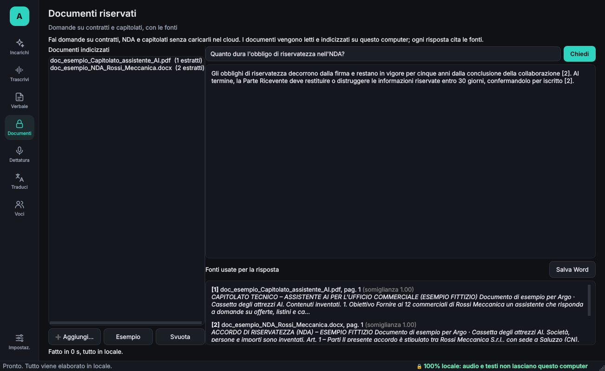
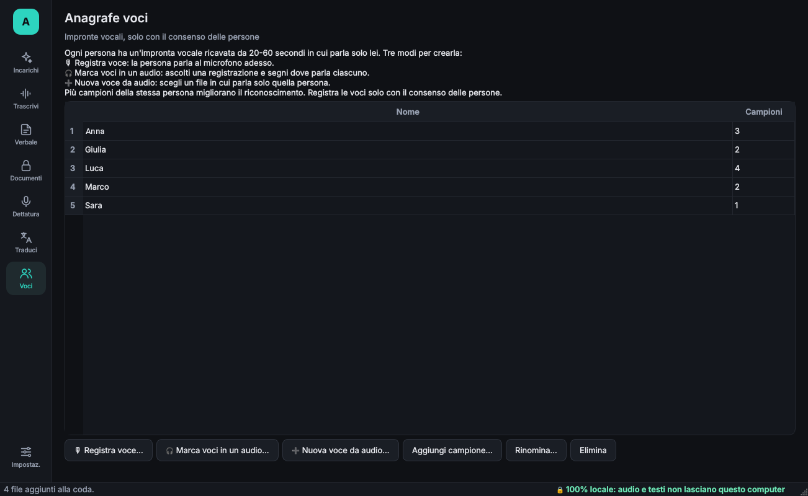
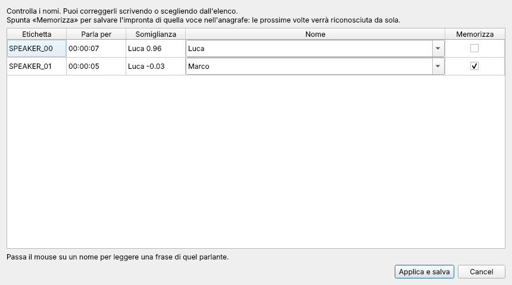
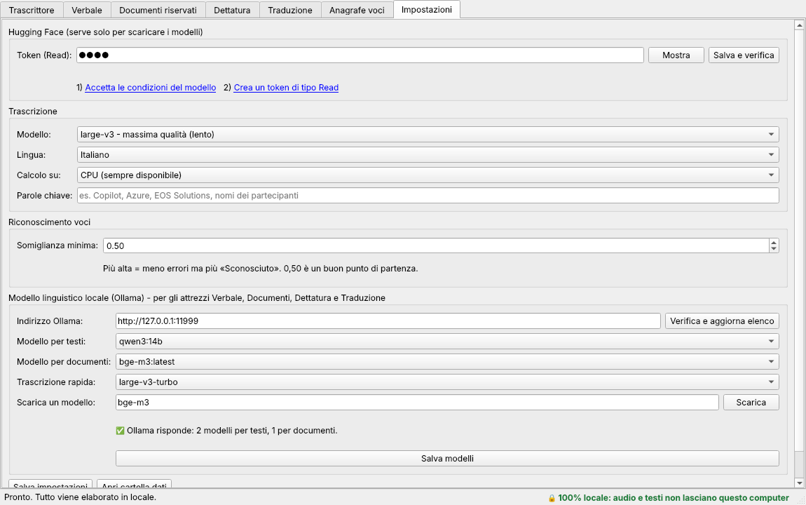

# Argo · Cassetta degli attrezzi AI

**Attrezzi di intelligenza artificiale che girano tutti sul tuo computer: niente audio né documenti nel cloud.**
*A toolbox of local AI tools: meeting transcription with speaker recognition, minutes, private document Q&A, dictation and glossary-aware translation. English summary below.*

| Attrezzo | Cosa fa | Motore locale |
| --- | --- | --- |
| **Incarichi** | In stile Cowork: «Call → recap + task» esegue trascrizione, verbale, Word, mail di recap e task in fila, con conferma dei nomi; con Microsoft 365 (facoltativo) bozza in Outlook e task in Planner | Tutti i motori qui sotto + Microsoft Graph (solo se collegato) |
| **Agenda** | Riunioni da Microsoft 365: briefing locale con i verbali precedenti, registrazione dal microfono, passaggio diretto agli Incarichi | Microsoft Graph (calendario) + Ollama |
| **Posta AI** | Assistente accanto a Outlook: riassunto, «cosa mi si chiede», risposta come bozza (mai inviata), task in Planner; lettura da attivare | Microsoft Graph (posta) + Ollama |
| **Registra** | Registra riunioni e call Teams (microfono + audio del computer). **Live**: trascrive mentre registri e cancella l'audio man mano, alla fine resta solo il testo. **Archivia**: salva la registrazione da trascrivere dopo | WhisperX + pyannote, WASAPI (Windows) / ScreenCaptureKit (macOS) |
| **Trascrittore** | Trascrive riunioni, separa le voci e riconosce chi parla grazie all'anagrafe delle voci | WhisperX + pyannote |
| **Verbale** | Dalla trascrizione al verbale: decisioni, azioni, responsabili, scadenze; oppure mail di sintesi al cliente | LLM via [Ollama](https://ollama.com) |
| **Documenti riservati** | Domande su NDA, contratti e capitolati (PDF, DOCX, TXT) con citazione delle fonti | Embedding + LLM via Ollama |
| **Dettatura** | Parli, e ottieni una mail o un appunto già scritti bene | faster-whisper + LLM |
| **Traduzione** | Traduce testi e trascrizioni IT/EN/DE rispettando il glossario aziendale | LLM via Ollama |

Nato come Trascrittore, costruito su [WhisperX](https://github.com/m-bain/whisperX) e [pyannote.audio](https://github.com/pyannote/pyannote-audio): trascrive file audio e video, separa le voci e, grazie a un'**anagrafe delle voci**, mette in automatico il nome giusto accanto a ogni intervento.

L'audio non lascia mai il computer: Internet serve solo per installare i pacchetti e scaricare i modelli la prima volta.




## Funzionalità

- **Nuova interfaccia «Studio»**: menu laterale, tema scuro o chiaro, corsie colorate dei parlanti nel Trascrittore.
- **Aggiornamenti dall'app**: Argo controlla su GitHub se c'è una versione nuova e si aggiorna con un clic (voci e impostazioni restano).
- **Canali Lab e Pro**: Lab per chi sperimenta; Pro accetta solo versioni rilasciate, verificate con firma e SHA-256 e con librerie a versione fissa, ed è governabile dall'IT con i criteri aziendali. Dettagli e roadmap in [docs/PRO.md](docs/PRO.md).
- **Anche i video delle call**: mp4, mov, mkv, webm (Teams, Zoom, Meet…); in *Marca voci* il video si vede, sincronizzato con l'audio.
- **Coda di trascrizioni**: trascini file o cartelle, imposti il numero di partecipanti, la coda lavora da sola e resta salvata anche chiudendo l'app.
- **Anagrafe voci**: un'impronta vocale per persona. Si crea registrando la voce dal microfono, da un file audio, da una riunione già trascritta, oppure **marcando sulla forma d'onda** i tratti in cui parla ciascuno.
- **Revisione parlanti**: correggi i nomi e memorizzi le voci nuove con una spunta.
- **Risultato leggibile**: `nome_nomi.txt` con orario e nome di chi parla, pronto per farne un verbale.
- **Esporta in Word**: trascrizioni, verbali, risposte sui documenti, dettature e traduzioni diventano file `.docx` già impaginati (titoli, elenchi, tabelle).
- **Impostazioni**: modello (large-v3, large-v3-turbo, medium, small), lingua, CPU o GPU NVIDIA, parole chiave, soglia di riconoscimento.

```
[00:00:12] Luca: Partiamo dal primo punto...

[00:00:41] Marco: Ok, sul budget però...
```

## Il "cervello" testuale: Ollama

Verbale, Documenti, Dettatura e Traduzione usano un modello linguistico locale servito da [Ollama](https://ollama.com) su `localhost`. Installa Ollama, poi scarica un modello per i testi e uno per i documenti, per esempio:

```bash
ollama pull gemma3:12b   # testi (circa 8 GB): adatto a un Mac da 16 GB
ollama pull bge-m3       # embedding multilingue per la ricerca nei documenti
```

In *Impostazioni → Modello linguistico locale* scegli i modelli tra quelli installati (puoi anche scaricarli da lì). La barra in basso mostra **🔒 100% locale** finché Ollama punta a questo computer.

Nella cartella `app/esempi` trovi una riunione, un NDA e un capitolato **fittizi** per provare subito tutti gli attrezzi.

## Requisiti

| Sistema | Supporto |
| --- | --- |
| Windows 10/11 x64 | Sì |
| Windows 11 ARM (es. Snapdragon) | Sì, in emulazione x64 (più lento: consigliato large-v3-turbo) |
| macOS Apple Silicon (M1 o successivi) | Sì (Homebrew facoltativo) |
| macOS Intel | No: PyTorch non pubblica più versioni per Mac Intel |
| Linux | Non ancora |

Servono anche circa 10 GB liberi e un account gratuito [Hugging Face](https://huggingface.co).

## Installazione

1. **Token Hugging Face (una volta sola)**
   - Accetta le condizioni del modello [pyannote/speaker-diarization-community-1](https://huggingface.co/pyannote/speaker-diarization-community-1).
   - Crea un token di tipo **Read** su [huggingface.co/settings/tokens](https://huggingface.co/settings/tokens).
2. **Scarica Argo ed estrailo**
   - Clic su **[⬇ Scarica Argo (ZIP)](https://github.com/Argo-s-new-dreams/argo-ai/archive/refs/heads/main.zip)**: parte subito il download di `argo-ai-main.zip`.
   - Estrai lo ZIP: su Windows tasto destro → *Estrai tutto…*; su Mac doppio clic. Ottieni la cartella `argo-ai-main`.
   - Non serve un account GitHub e non devi usare Git: è un normale file da scaricare.
3. **Avvia l'installer**
   - Windows: doppio clic su `Installa-Argo.bat`. Se compare SmartScreen: *Ulteriori informazioni → Esegui comunque*.
   - macOS: tasto destro su `Installa-Argo.command` → *Apri*. Se macOS lo blocca: *Impostazioni di Sistema → Privacy e sicurezza → Apri comunque*.
4. **Apri Argo AI** (Desktop/menu Start su Windows, Applicazioni su Mac), incolla il token in *Impostazioni* e premi **Salva e verifica**.

Gli installer non sono firmati digitalmente: per questo Windows e macOS mostrano un avviso. Il codice è tutto qui, leggibile.

## Uso in breve

1. *Voci → ＋ Nuova voce ▾*: nome + 20-60 secondi in cui parla solo quella persona (dal microfono, da un file o segnandola in una registrazione).
2. *Trascrivi*: trascina i file, imposta i partecipanti, **Avvia coda**.
3. A fine lavoro: **Apri trascrizione** oppure **✏️ Nomi dei parlanti…** per correggere i nomi e spuntare **Memorizza**.

| Anagrafe voci | Revisione parlanti | Impostazioni |
| --- | --- | --- |
|  |  |  |

🆕 **Novità:** [CHANGELOG.md](CHANGELOG.md), con l'elenco delle versioni e delle migliorie.

📖 **Manuale completo:** [docs/MANUALE.md](docs/MANUALE.md): installazione, tutti gli attrezzi, impostazioni, dati, risoluzione dei problemi, privacy e AI Act.

## Privacy e dati

- Elaborazione solo locale; la telemetria anonima di pyannote è disattivata dall'app.
- I dati stanno in `whisperx-env` nella cartella utente: `voci/` (impronte), `.hf_token`, impostazioni e coda. Le trascrizioni vengono salvate accanto ai file audio.
- **Le impronte vocali sono dati biometrici** (art. 9 GDPR): registra e memorizza le voci altrui solo con il consenso esplicito delle persone interessate e informa sempre i partecipanti che la riunione viene registrata.

### AI Act

Riconoscere una persona confrontando la sua voce con un'anagrafe di impronte è **identificazione biometrica** ai sensi del Regolamento (UE) 2024/1689 (art. 3, punto 35).

- **Uso personale e non professionale:** gli obblighi del regolamento per chi usa il sistema non si applicano (art. 2, par. 10).
- **Uso professionale** (riunioni di lavoro, clienti, colleghi): il riconoscimento dei partecipanti può rientrare tra i sistemi di identificazione biometrica remota ad alto rischio (Allegato III, punto 1(a)), i cui obblighi si applicano dal 2 dicembre 2027 dopo l'Omnibus digitale. Valutalo con il tuo consulente prima di usarlo in azienda.
- **Funzioni da non aggiungere:** l'art. 5 vieta il riconoscimento delle emozioni sul luogo di lavoro e la categorizzazione biometrica su caratteristiche sensibili.
- La sola trascrizione con parlanti anonimi ("Parlante 1", "Parlante 2"), senza anagrafe, è l'uso meno delicato.

Queste note sono informative e non costituiscono consulenza legale.

## Struttura

| Percorso | Contenuto |
| --- | --- |
| `app/trascrittore.py` | Interfaccia grafica (PySide6): coda, anagrafe, impostazioni, revisione |
| `app/voci_core.py` | Motore: impronte vocali, identificazione, comando WhisperX; usabile anche da riga di comando |
| `app/argo_attrezzi.py` | Attrezzi Verbale, Documenti riservati, Dettatura, Traduzione e pannello Ollama |
| `app/m365.py` | Connettore facoltativo a Microsoft 365: calendario, bozze di Outlook, Planner |
| `app/agenda_posta.py` | Agenda e Posta AI (Microsoft 365, facoltativo) |
| `app/incarichi.py` | Incarichi in stile Cowork: ricetta Call → verbale + recap + task |
| `app/tema.py` | Tema scuro/chiaro, icone e menu laterale |
| `app/dettaglio.py` | Dettaglio della trascrizione con le corsie dei parlanti |
| `app/aggiornamenti.py` | Controllo e installazione degli aggiornamenti da GitHub |
| `app/registrazione.py` | Pagina Registra: modalità Live e Archivia, consenso, recupero delle sessioni interrotte |
| `app/cattura_audio.py` | Cattura di microfono e audio del computer (WASAPI loopback, ScreenCaptureKit, BlackHole…) e mixer a 16 kHz |
| `app/live_core.py` | Live: taglio sui silenzi, continuità dei parlanti tra i blocchi, cancellazione dei blocchi trascritti |
| `app/live_motore.py` | Processo di trascrizione della Live: carica i modelli una volta e trascrive i blocchi |
| `app/voci_strumenti.py` | Registrazione delle voci dal microfono e marcatura delle voci su forma d'onda |
| `app/esporta_word.py` | Esportazione in Word (.docx) dei testi prodotti dagli attrezzi |
| `app/llm_locale.py` | Client minimale per Ollama: chat in streaming, embedding, download modelli |
| `app/cloud.py` | Modelli cloud facoltativi (Claude, GitHub Models, Ollama Cloud), scelti attrezzo per attrezzo e limitabili dai criteri aziendali |
| `app/modelli_ollama.py` | All'avvio: accende Ollama se serve, propone i modelli consigliati (gemma3, bge-m3) e li sceglie |
| `app/risorse.py` | «Uso del computer»: core, priorità e memoria concessi a WhisperX e Ollama, un lavoro pesante alla volta sui PC leggeri |
| `app/esempi/` | Riunione, NDA e capitolato fittizi per le prove |
| `docs/MANUALE.md` | Manuale d'uso completo |
| `installer/installa_windows.ps1` | Installer Windows (lanciato da `Installa-Argo.bat`) |
| `Installa-Argo.command` | Installer macOS, crea `~/Applications/Argo AI.app` |

## Stato del progetto

Progetto personale, fornito **così com'è**, senza garanzie né supporto. Segnalazioni e suggerimenti sono benvenuti tramite le issue, ma le risposte non sono garantite.

## Licenza

Codice rilasciato con licenza [MIT](LICENSE). Le dipendenze e i modelli hanno le proprie licenze: vedi [THIRD_PARTY_LICENSES.md](THIRD_PARTY_LICENSES.md).

---

## English summary

**Argo** is a local AI toolbox (Windows x64/ARM, macOS Apple Silicon): a transcriber built on WhisperX and pyannote.audio, plus minutes, private document Q&A, dictation and glossary-aware translation powered by a local LLM through Ollama. It transcribes audio/video files, separates speakers and labels them by name using a local **voice registry**. Everything runs locally; the internet is only needed to install packages and download models once.

1. Accept the conditions of [pyannote/speaker-diarization-community-1](https://huggingface.co/pyannote/speaker-diarization-community-1) and create a **Read** token on Hugging Face.
2. [Download the ZIP](https://github.com/Argo-s-new-dreams/argo-ai/archive/refs/heads/main.zip) and extract it.
3. Run `Installa-Argo.bat` (Windows) or `Installa-Argo.command` (macOS, right-click → Open).
4. Open the app, paste the token in *Impostazioni* (Settings), enroll voices, queue your files.

The UI and the [full manual](docs/MANUALE.md) are in Italian. Voiceprints are biometric data: enroll other people's voices only with their explicit consent. Under the EU AI Act, recognising people from their voice against a stored registry is biometric identification: personal non-professional use is outside the deployer obligations, while professional use may fall under the high-risk category (Annex III, point 1(a)), applicable from 2 December 2027. Personal project, provided as is, MIT licensed; not legal advice.
