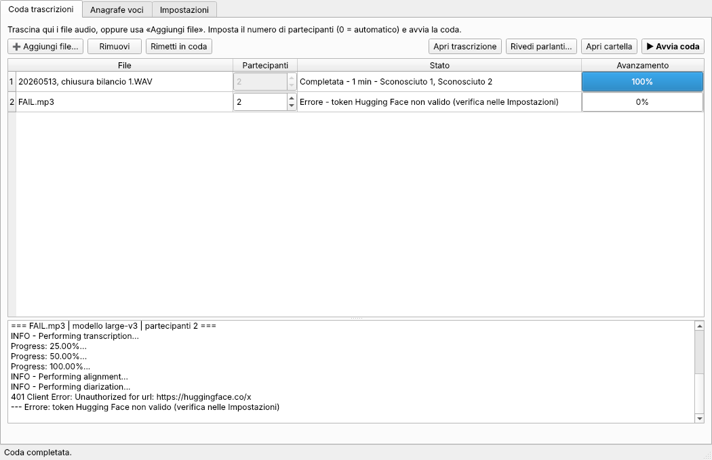
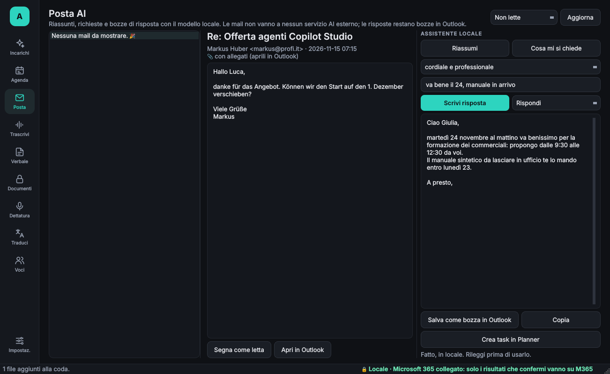

# Manuale di Argo · Cassetta degli attrezzi AI

*Versione del manuale: 20261120.2033 · riferita all'app versione 20261120.2033*

Argo è una cassetta degli attrezzi di intelligenza artificiale che lavora **tutta sul tuo computer**. Gli attrezzi principali:

- **Registra**: registra riunioni e call Teams; in modalità Live trascrive mentre registri e non conserva l'audio.
- **Trascrittore**: trascrive riunioni e riconosce chi parla.
- **Verbale**: trasforma una trascrizione in un verbale.
- **Documenti riservati**: risponde a domande su documenti riservati.
- **Dettatura**: trasforma la tua voce in testo già scritto bene.
- **Traduzione**: traduce rispettando il glossario aziendale.

Audio, documenti e testi non vengono mai inviati a servizi cloud.

---

## Indice

1. [Come è fatta Argo](#1-come-è-fatta-argo)
2. [Requisiti](#2-requisiti)
3. [Installazione](#3-installazione)
4. [Primo avvio e configurazione](#4-primo-avvio-e-configurazione) · [L'interfaccia](#4bis-linterfaccia) · [Registra](#4ter-registra)
5. [Trascrittore](#5-trascrittore) · [Incarichi](#5bis-incarichi) · [Agenda](#5ter-agenda) · [Posta AI](#5quater-posta-ai) · [Secondo cervello](#5quinquies-secondo-cervello)
6. [Anagrafe voci](#6-anagrafe-voci)
7. [Verbale](#7-verbale)
8. [Documenti riservati](#8-documenti-riservati)
9. [Dettatura](#9-dettatura)
10. [Traduzione con glossario](#10-traduzione-con-glossario)
11. [Impostazioni nel dettaglio](#11-impostazioni-nel-dettaglio) · [I documenti Word](#11bis-i-documenti-word)
12. [Dove stanno i dati](#12-dove-stanno-i-dati)
13. [Uso da riga di comando](#13-uso-da-riga-di-comando)
14. [Aggiornare e disinstallare](#14-aggiornare-e-disinstallare)
15. [Risoluzione dei problemi](#15-risoluzione-dei-problemi)
16. [Privacy, GDPR e AI Act](#16-privacy-gdpr-e-ai-act)
17. [Domande frequenti](#17-domande-frequenti)

---

## 1. Come è fatta Argo

Argo usa due "motori", entrambi locali.

| Motore | Cosa fa | Usato da |
| --- | --- | --- |
| **WhisperX + pyannote** (dentro Argo) | Trascrizione parlato → testo, allineamento parola per parola, separazione dei parlanti, impronte vocali | Trascrittore, Anagrafe voci |
| **faster-whisper** (dentro Argo) | Trascrizione semplice, senza parlanti | Dettatura, Traduzione (da audio) |
| **Ollama** (programma a parte) | Modello linguistico (LLM) che scrive e ragiona sui testi, più un modello di *embedding* per cercare nei documenti | Verbale, Documenti riservati, Dettatura, Traduzione |

**Quando serve Internet:**

- per installare i pacchetti;
- per scaricare i modelli la prima volta (WhisperX/pyannote da Hugging Face, LLM da Ollama).

Dopo l'installazione il lavoro avviene offline.

**Modelli e licenze.** Per allineare le parole all'audio in italiano, francese, tedesco e spagnolo, Argo usa i modelli wav2vec2 di Jonatas Grosman (licenza Apache-2.0, uso commerciale consentito), circa 1,2 GB per lingua scaricati una volta. Il predefinito di WhisperX per queste lingue, VoxPopuli, ha licenza non commerciale e non va bene per il lavoro. Licenze di tutti i componenti e modelli: [THIRD_PARTY_LICENSES.md](../THIRD_PARTY_LICENSES.md). Chi usa Gemma (il modello consigliato per i testi) accetta i [Gemma Terms of Use](https://ai.google.dev/gemma/terms).

La barra in basso nella finestra mostra **🔒 100% locale** finché Ollama punta a questo computer (`localhost`). Se nelle impostazioni indichi un server Ollama su un'altra macchina, il badge te lo segnala.

---

## 2. Requisiti

### Sistemi supportati

| Sistema | Supporto | Note |
| --- | --- | --- |
| Windows 10/11 x64 | Sì | GPU NVIDIA facoltativa |
| Windows 11 ARM (es. Snapdragon) | Sì | Gira in emulazione x64: più lento, consigliato `large-v3-turbo` |
| macOS Apple Silicon (M1 e successivi) | Sì | Homebrew non serve (se c'è, viene usato) |
| macOS Intel | No | PyTorch non pubblica più versioni per Mac Intel |
| Linux | Non ancora | Il codice Python è portabile, ma manca l'installer |

### Spazio e memoria

- **Disco:** circa 10 GB per Python, librerie e modelli di trascrizione. Ogni modello Ollama occupa da qualche GB in su (per esempio `gemma3:12b` circa 8 GB).
- **RAM:** per il modello linguistico conta la memoria. Con 16 GB sono adatti modelli intorno ai 12-14 miliardi di parametri. Con meno memoria scegli modelli più piccoli.

### Account

- Un account gratuito [Hugging Face](https://huggingface.co), che serve solo per scaricare il modello di separazione dei parlanti.

---

## 3. Installazione

### 3.1 Token Hugging Face (una volta sola)

1. Accedi a Hugging Face.
2. Apri la pagina del modello [pyannote/speaker-diarization-community-1](https://huggingface.co/pyannote/speaker-diarization-community-1) e accetta le condizioni d'uso.
3. Vai su [huggingface.co/settings/tokens](https://huggingface.co/settings/tokens) → **Create new token** → tipo **Read** → copia il token (inizia con `hf_`).

> Tratta il token come una password: non incollarlo in chat, email o documenti condivisi. Se lo esponi per errore, revocalo e creane uno nuovo.

### 3.2 Scarica Argo

1. Clic su **[⬇ Scarica Argo (ZIP)](https://github.com/Argo-s-new-dreams/argo-ai/archive/refs/heads/main.zip)**: il browser scarica il file `argo-ai-main.zip` (di solito nella cartella *Download*).
2. Estrai lo ZIP:
   - **Windows:** tasto destro sul file → *Estrai tutto…* → *Estrai*. Non avviare l'installer dall'anteprima dello ZIP: prima va estratto.
   - **Mac:** doppio clic sul file.
3. Ottieni la cartella `argo-ai-main`, che contiene gli installer del passo successivo.

Non serve un account GitHub né usare Git: è un normale download. In alternativa, dalla pagina [github.com/Argo-s-new-dreams/argo-ai](https://github.com/Argo-s-new-dreams/argo-ai) puoi usare il pulsante verde **Code → Download ZIP**, che scarica lo stesso file.

### 3.3 Avvia l'installer

**Windows**

1. Doppio clic su `Installa-Argo.bat`.
2. Se compare SmartScreen: *Ulteriori informazioni → Esegui comunque*.
3. L'installer:
   - sblocca i file scaricati;
   - installa `uv` e `ffmpeg` con winget se mancano;
   - crea l'ambiente Python 3.12 x64 in `%USERPROFILE%\whisperx-env`;
   - installa le librerie;
   - crea il collegamento **Argo AI** sul Desktop e nel menu Start;
   - ti chiede se installare **Ollama** (circa 1,5 GB, con winget). Se c'è già salta il passo.

**macOS (Apple Silicon)**

1. Tasto destro su `Installa-Argo.command` → **Apri**. Se macOS lo blocca: *Impostazioni di Sistema → Privacy e sicurezza → Apri comunque*.
2. L'installer:
   - prepara `uv` e `ffmpeg`: se c'è [Homebrew](https://brew.sh) usa quello, altrimenti scarica `uv` dal sito ufficiale (astral.sh) e prende `ffmpeg` dal pacchetto Python `imageio-ffmpeg`, dentro la cartella di Argo. Non servono password di amministratore;
   - crea l'ambiente in `~/whisperx-env`;
   - installa le librerie;
   - crea l'app **Argo AI** in `~/Applications`;
   - ti chiede se installare **Ollama**: scarica `Ollama.dmg` dalla pagina ufficiale delle versioni su GitHub e copia l'app in `/Applications` (o in `~/Applications` se non hai i permessi). Ollama richiede macOS Sonoma (14) o successivo. Se c'è già salta il passo.

Gli installer non sono firmati digitalmente, per questo i sistemi mostrano un avviso. Il codice è tutto leggibile nel repository.

> Se hai una versione precedente chiamata "Trascrittore", l'installer la sostituisce. Voci, impostazioni e coda restano dove sono.

### 3.4 Ollama (per Verbale, Documenti, Dettatura, Traduzione)

L'installer lo installa per te se rispondi **S** all'ultimo passo. Se hai risposto no, o il download non è riuscito, alla fine l'installer te lo ricorda; puoi farlo a mano così:

1. Scarica Ollama da [ollama.com/download](https://ollama.com/download) e avvialo.
2. Scarica almeno un modello per i testi e uno per gli embedding. Per esempio, da Terminale o PowerShell:

```bash
ollama pull gemma3:12b   # testi, circa 8 GB: adatto a 16 GB di RAM
ollama pull bge-m3       # embedding multilingue per i documenti
```

Più semplice: al primo avvio Argo **accende Ollama** (se è installato ma spento) e, se mancano, **propone di scaricare i modelli consigliati** e li sceglie da solo. Vedi [§11.4](#114-modello-linguistico-locale-ollama).

Senza Ollama il Trascrittore e l'Anagrafe voci funzionano lo stesso. La Dettatura in modalità *Solo trascrizione* non ha bisogno di Ollama.

---

## 4. Primo avvio e configurazione

1. Apri **Argo AI**. Al primo avvio un messaggio ti ricorda di inserire il token.
2. Scheda **Impostazioni** → incolla il token in *Hugging Face* → **Salva e verifica**. Argo controlla il token sul sito di Hugging Face e ti dice se:
   - va bene;
   - è sbagliato o scaduto;
   - non hai ancora accettato le condizioni del modello.
3. In *Trascrizione* scegli modello e lingua (per cominciare: `large-v3-turbo`, Italiano) → **Salva impostazioni**.
4. In *Modello linguistico locale* premi **Verifica e aggiorna elenco**, scegli il modello per i testi e quello per gli embedding → **Salva modelli**.

**Per una prova veloce senza materiale tuo:** la cartella `app/esempi` contiene una riunione, un NDA e un capitolato, tutti **fittizi**. I pulsanti *Usa l'esempio* ed *Esempio* li caricano.

---

## 4bis. L'interfaccia

- **Menu laterale a icone, in due gruppi nell'ordine del lavoro:**
  - **Riunioni:** Agenda → Registra → Trascrivi → Verbale → Incarichi (dalla call al verbale e ai task);
  - **Attrezzi:** Posta, Documenti, Dettatura, Traduci;
  - in fondo **Voci** e **Impostazioni**. Passando il mouse su un'icona compare il nome completo.
- **Ogni pagina si usa allo stesso modo:** sotto il titolo c'è una riga che dice a cosa serve (e quando usare un'altra pagina); poi la barra dei comandi, con l'**azione principale** (pulsante terracotta) **per prima a sinistra**, seguita dalle scelte e dai file da aprire; a destra ciò che fai col risultato (**Copia**, **Salva ▾**). I pulsanti che non puoi ancora usare non compaiono finché non servono.
- **Pannelli vuoti:** mostrano il logo in filigrana e una frase con il passo da fare.
- **Tema:** **Notte** (scuro, predefinito), **Carta** (chiaro), oppure come il sistema. Colori, marchio e carattere (Roboto) vengono dal Brand Book di Argo's New Dreams e seguono il design system «Stile Argo», con contrasti verificati (WCAG 2.2 AA). Si sceglie in *Impostazioni → Aspetto* e cambia subito, senza riavviare.
- **Bollino in basso a destra:** *100% locale* finché il modello linguistico gira su questo computer. Se punti Ollama a un'altra macchina, il bollino lo segnala.



## 4ter. Registra

Registra riunioni in presenza e **call Teams**. Argo prende due sorgenti e le mescola in un'unica traccia:

- il **microfono**, cioè la tua voce e quella di chi è nella stanza;
- l'**audio del computer**, cioè le voci degli altri partecipanti alla call, che escono dagli altoparlanti o dalle cuffie.

### Le due modalità

| Modalità | Cosa resta sul computer | Quando usarla |
| --- | --- | --- |
| **Live** | Solo il **testo**. Argo taglia l'audio in blocchi di 20-45 secondi, sui silenzi; trascrive ogni blocco appena è pronto e lo **cancella** subito dopo averne salvato il testo. La registrazione intera non esiste mai. | Riunioni di lavoro, dati riservati, quando vuoi ridurre al minimo i dati conservati |
| **Archivia** | La **registrazione completa** in `Documenti/Argo/Registrazioni`, da trascrivere quando vuoi con **Metti in coda in Trascrivi →** | Quando vuoi poter riascoltare, o la massima qualità del riconoscimento dei parlanti |

### Come si usa

1. Scegli la modalità e scrivi un titolo (facoltativo). Controlla le **sorgenti** (vedi sotto): con *Automatico* va bene quasi sempre.
2. Premi **● Avvia**. Argo ti chiede di confermare che i partecipanti sono stati **informati**: una registrazione fatta con Argo, a differenza di quella di Teams, non avvisa nessuno. Con **Copia l'avviso** hai il testo da incollare nella chat della riunione.
3. Durante la registrazione vedi i due livelli (microfono e audio del computer) e, in Live, il testo che compare blocco dopo blocco, con 20-45 secondi di ritardo.
4. Premi **■ Ferma**. In Live, Argo finisce di trascrivere i blocchi rimasti e salva `data ora titolo (live)_nomi.txt` (più il `.json`) nella cartella delle registrazioni. Con **Apri nel Verbale →** passi subito al verbale; con **⬇️ Scarica ▾** salvi la trascrizione in Word o in WebVTT (§5.4).

> **Usa le cuffie nelle call.** Senza cuffie il microfono riprende anche le voci che escono dagli altoparlanti, e le stesse frasi arrivano due volte con un piccolo ritardo.

### Le sorgenti

| Riga | Scelte | Volume |
| --- | --- | --- |
| **Microfono** | *Predefinito del sistema* oppure un dispositivo preciso: microfono interno, cuffie, microfono USB | Da 0 a 200% |
| **Audio del computer** | *Automatico* (il metodo migliore disponibile), *Nessuno: solo microfono* (riunione in presenza), il metodo nativo del sistema oppure un dispositivo di loopback preciso (BlackHole…) | Da 0 a 200% |

- I **volumi** si regolano anche durante la registrazione. Usali per bilanciare: se gli altri si sentono poco rispetto a te, alza l'audio del computer.
- Accanto a ogni riga, la barra del **livello** si muove quando la sorgente riceve audio.
- **Aggiorna elenco** rilegge i dispositivi dopo aver collegato cuffie o microfoni. Un dispositivo salvato ma scollegato compare come *(non collegato)*.
- Argo ricorda le scelte e i volumi per la volta successiva.

### L'audio del computer

| Sistema | Come lo prende Argo | Cosa serve |
| --- | --- | --- |
| **Windows** | WASAPI loopback: l'audio degli altoparlanti o delle cuffie predefiniti | Niente. Scegli in Teams lo stesso dispositivo di uscita predefinito di Windows |
| **macOS 13 e successivi** | ScreenCaptureKit, solo l'audio (lo schermo non viene registrato) | La prima volta macOS chiede il permesso: *Impostazioni di Sistema → Privacy e sicurezza → Registrazione schermo e audio di sistema → Argo AI*. Dopo averlo concesso, riapri Argo |
| **Ripiego** | Un dispositivo di loopback già installato: BlackHole, Missaggio stereo, VB-CABLE… | Argo lo trova da solo se ScreenCaptureKit o WASAPI non sono disponibili |

Se l'audio del computer non è disponibile, Argo registra solo il microfono e lo scrive in chiaro sotto le sorgenti.

### Live: cosa sapere

- **Parlanti tra un blocco e l'altro.** Chi è nell'anagrafe viene riconosciuto per nome in ogni blocco. Le persone sconosciute ricevono «Sconosciuto 1, 2…» e Argo le riconosce da un blocco all'altro confrontando la voce con quanto ha già sentito. La precisione è un po' inferiore a quella della trascrizione del file intero: è il prezzo del non conservare l'audio. Dopo la sessione puoi correggere i nomi con la revisione, come per le altre trascrizioni.
- **Velocità.** La Live usa `large-v3-turbo` (impostazione `modello_live`). Se il computer è più lento del parlato, i blocchi si accodano e Argo finisce di trascriverli dopo **Ferma**. In attesa resta solo l'audio non ancora trascritto.
- **Dove stanno i blocchi in attesa.** In `whisperx-env/live/<sessione>/`, una cartella leggibile solo dal tuo utente. Ogni blocco viene sovrascritto con zeri e cancellato appena il suo testo è salvato. A fine sessione la cartella sparisce.
- **Se Argo si chiude a metà** (o il computer si spegne), al prossimo ingresso in *Registra* Argo propone di trascrivere il resto oppure di cancellare l'audio rimasto e salvare il testo già pronto.
- **Scarta l'audio rimasto e concludi** chiude subito: perdi la parte non ancora trascritta, il resto viene salvato.

### Criteri aziendali

L'IT può limitare la pagina con `criteri.json` (vedi [PRO.md](PRO.md)): `"registrazione": "solo_live"` lascia solo la Live, `"nessuna"` disattiva la registrazione.

---

## 5. Trascrivi

La pagina del Trascrittore (nel menu: *Trascrivi*). In alto **▶ Avvia coda** e **+ Aggiungi file…**. A sinistra c'è la **coda** di file audio o video da trascrivere; a destra il **dettaglio** del file selezionato:

- le **corsie dei parlanti**, una per persona, colorate, che mostrano quando parla ciascuno lungo la registrazione;
- la **trascrizione** con i nomi colorati allo stesso modo;
- i pulsanti *Nomi dei parlanti*, *Marca voci*, *Apri testo*, *Word* e *Verbale →*, che compaiono quando scegli un file (*Marca voci* anche prima della trascrizione, gli altri a trascrizione completata).

Le stesse azioni sono anche nel menu col **tasto destro** sulle righe della coda.

### 5.1 Formati accettati

Audio: `wav`, `mp3`, `m4a`, `aac`, `flac`, `ogg`, `opus`, `wma`.
Video: `mp4`, `mov`, `mkv`, `webm`, `m4v`, `avi`, `wmv`: per esempio le registrazioni delle call di Teams o Zoom. Argo ne usa solo l'audio; il file video resta dov'è e non viene modificato.

### 5.2 Aggiungere file

- Trascina file o intere cartelle nella finestra, oppure usa **➕ Aggiungi file…**.
- Nella colonna **Partecipanti** indica quante persone parlano. Se il numero è giusto, la separazione delle voci migliora molto. Con `0` decide il modello.

### 5.3 Avviare e seguire il lavoro

- **▶ Avvia coda** elabora uno dopo l'altro tutti i file *In attesa*.
- La colonna **Avanzamento** mostra le tre fasi: *Trascrizione*, *Allineamento*, *Riconoscimento parlanti*.
- Stati possibili:

| Stato | Significato |
| --- | --- |
| In attesa | Pronto da elaborare |
| In corso | In lavorazione |
| Completata | Trascrizione pronta |
| Errore | Qualcosa è andato storto: guarda il log in basso |
| Interrotta | Fermata da te o dalla chiusura dell'app |

- La coda viene salvata: se chiudi Argo, la ritrovi alla riapertura.
- **Il computer resta sveglio** finché Argo lavora (trascrizione, registrazione e Live, relazioni, incontri da file, attrezzi con il modello linguistico): niente sospensione automatica per inattività; lo schermo può spegnersi lo stesso. Il **coperchio chiuso** o il **tasto di accensione** mandano comunque il computer in sospensione: se succede durante una trascrizione, Argo se ne accorge e la **rimette in coda da sola una volta**, ripartendo da capo appena il computer si risveglia. Per i lavori lunghi tieni il portatile aperto e alla corrente.
- **Tasto destro** su una riga apre un menu con tutte le azioni: trascrizione, nomi, Word, verbale, Marca voci, rimetti in coda, cartella, rimuovi. **Canc** (o ⌫ sul Mac) rimuove le righe selezionate.
- **■ Ferma coda** interrompe il file in lavorazione e chiude tutti i processi di WhisperX. Se premi subito di nuovo *Avvia*, Argo può chiederti di attendere qualche secondo che la chiusura finisca.
- **Rimetti in coda** riporta in *In attesa* un file con errore o interrotto. Su una trascrizione completata ti chiede se rifare **solo i parlanti** o **tutta la trascrizione**. **Rimuovi** toglie il file dalla lista senza cancellarlo.

### 5.3bis Cambiare il numero di partecipanti dopo la trascrizione

Se la separazione delle voci non torna (per esempio ha trovato 2 persone ma erano 3), cambia il numero nella colonna **Partecipanti** anche su una riga *Completata*. Argo chiede conferma e **rifà solo la separazione dei parlanti**: il testo trascritto resta lo stesso, e ci vuole molto meno di una trascrizione completa. Alla fine la riga torna *Completata* con i nuovi parlanti; i nomi corretti a mano vanno riassegnati.

> La prima trascrizione scarica i modelli (alcuni GB, compreso il modello di allineamento della lingua, circa 1,2 GB): è normale che ci metta di più. Chi aggiorna da una versione precedente lo scarica alla prima trascrizione dopo l'aggiornamento.

### 5.4 Risultati

Accanto al file audio Argo salva:

- `nomefile.json`: il risultato completo di WhisperX, con le impronte vocali dei parlanti;
- `nomefile_nomi.txt`: la trascrizione leggibile, con orario e nome.

```
[00:00:12] Luca: Partiamo dal primo punto...

[00:00:41] Marco: Ok, sul budget però...
```

I parlanti non riconosciuti compaiono come **Sconosciuto 1**, **Sconosciuto 2** e così via.

Pulsanti disponibili sulla riga selezionata:

- **Apri trascrizione**: apre il file `_nomi.txt`.
- **✏️ Nomi dei parlanti…** (oppure doppio clic sulla riga completata): apre la revisione dei nomi (vedi sotto).
- **Apri cartella**: apre la cartella del file.
- **⬇️ Scarica trascrizione** (pulsante *⬇️ Scarica ▾* nel dettaglio, o tasto destro sulla riga): **Word (.docx)**, **sottotitoli WebVTT (.vtt)** oppure **Word e WebVTT** insieme in una cartella. Il Word ha un paragrafo per intervento, con l'orario e il nome del parlante in grassetto, e si apre da solo. Il WebVTT ha una riga di sottotitolo per frase con inizio e fine al millesimo di secondo e il parlante nel tag di voce `<v Nome>`; le frasi più lunghe di circa 7 secondi o 120 caratteri sono divise. Va bene per un lettore video, per Microsoft Stream o per caricarlo accanto alla registrazione. Lo stesso pulsante c'è in **Registra** dopo una Live e negli **Incontri** (*Salva ▾* e tasto destro).
- **Crea verbale →**: passa la trascrizione alla scheda Verbale.

### 5.5 Nomi dei parlanti (revisione)

La finestra mostra, per ogni voce trovata:

- l'etichetta del modello (`SPEAKER_00`…);
- quanto tempo ha parlato;
- la somiglianza con la voce dell'anagrafe più vicina;
- il nome assegnato.

1. Passa il mouse su un nome per leggere una frase di quel parlante e capire chi è.
2. Correggi il nome dal menu a tendina, oppure scrivine uno nuovo.
3. Spunta **Memorizza** per salvare l'impronta di quella voce nell'anagrafe: dalla volta successiva verrà riconosciuta da sola.
4. Conferma con **Applica e salva**: Argo riscrive il `_nomi.txt` con i nomi corretti.

I nomi scelti restano **salvati** (dentro il file `.json` della trascrizione): riaprendo la finestra li ritrovi, e li puoi correggere quante volte vuoi. Le etichette lasciate come *Sconosciuto* invece vengono ricalcolate: se poi aggiungi quella voce all'anagrafe, alla riapertura la trovi già riconosciuta.

**Due etichette sono la stessa persona?** Dai loro lo stesso nome: nella trascrizione i loro interventi vengono uniti. **Mancano persone?** Cambia il numero di partecipanti (vedi §5.3bis).

### 5.6 Consigli per una buona trascrizione

- Registra vicino a chi parla. Un microfono da riunione o le registrazioni di Teams vanno bene.
- Imposta il numero esatto di partecipanti.
- In *Parole chiave* metti termini tecnici, nomi di aziende e nomi dei partecipanti: il modello li scrive meglio.
- Le voci sovrapposte restano il punto debole di qualsiasi sistema di separazione dei parlanti.

---

## 5bis. Incarichi

Gli **Incarichi** funzionano in stile *Cowork*: Argo esegue più attrezzi in fila al posto tuo. Tu vedi il piano, approvi i passi importanti e alla fine trovi i risultati nella cartella della call.


### La ricetta «Call → recap + task»

1. **Scegli audio o video** della call. Se è già stata trascritta (c'è il `.json` accanto), la trascrizione viene saltata.
2. Indica, se vuoi:
   - il numero di **partecipanti**;
   - i **destinatari** della mail;
   - la **lingua** della mail (italiano, inglese o tedesco) e il **tono**;
   - **indicazioni aggiuntive**, per esempio «metti in evidenza le scadenze».
3. Premi **▶ Esegui l'incarico**. Il piano ha sei passi:

| Passo | Cosa fa | Risultato nella cartella |
| --- | --- | --- |
| Trascrizione con i parlanti | Mette il file nella coda del Trascrittore e aspetta che finisca | `nome.json`, `nome_nomi.txt` |
| Nomi dei parlanti | **Si ferma e chiede conferma**: *Correggi nomi…* apre la revisione, *Conferma* va avanti | — |
| Verbale | Verbale con decisioni, azioni e punti aperti (anche per riunioni lunghe) | `nome_verbale.md` |
| Verbale in Word | Lo stesso verbale impaginato | `nome_verbale.docx` |
| Mail di recap | Bozza di mail con oggetto, sintesi e prossimi passi | `nome_recap_mail.txt` |
| Task dalle azioni | Elenco di cose da fare con responsabile e scadenza | `nome_task.csv`, `nome_task.json` |

4. A destra, in **Risultati**, trovi la mail (modificabile), la tabella dei task, il verbale e l'elenco dei file. Con **Copia mail** e **Copia task** li incolli in Outlook, Teams o Planner.

### Le regole di sicurezza

- **Niente viene sovrascritto:** se un file esiste già, Argo crea `_2`, `_3`…
- **Niente viene inviato:** la mail resta una bozza. Senza Microsoft 365 la copi; con Microsoft 365 collegato finisce nelle **Bozze** di Outlook e la invii tu.
- **Registro:** ogni incarico scrive `nome_incarico_registro.txt` con ora e passi eseguiti, utile per sapere cosa ha fatto l'AI e quando.
- **■ Ferma l'incarico** interrompe in qualsiasi momento; i file già creati restano.

Le ricette *Contratti → confronto* e *Riunione DE → verbale IT* sono indicate come «prossimamente».

### Con Microsoft 365 collegato (facoltativo)

Se colleghi il tuo account (vedi [§11.5](#115-microsoft-365-facoltativo)), l'incarico ha tre aiuti in più.

- **Dal calendario:** il pulsante accanto ai destinatari cerca nel tuo calendario la riunione più vicina all'ora della registrazione. Inserisce titolo e partecipanti con le email; togli chi non deve ricevere il recap.
- **Bozza in Outlook** (passo 7): Argo ti mostra a chi andrà la mail e **chiede conferma**. Con *Crea bozza* la trovi nelle **Bozze** di Outlook, con *Apri* per aprirla; non viene mai inviata da sola. Prima di confermare puoi modificare il testo nella scheda *Mail*.
- **Task in Planner** (passo 8):
  - scegli il piano dall'elenco dei tuoi piani; i task finiscono nel primo bucket, con la scadenza quando è chiara;
  - un task viene **assegnato** solo se il responsabile corrisponde senza ambiguità a un partecipante della riunione; gli altri restano da assegnare;
  - *Salta* lascia tutto com'è.

Su Microsoft 365 vanno solo **la bozza e i task che confermi**; Argo legge il calendario. Audio, trascrizioni e documenti restano sul computer.

---

## 5ter. Agenda

*Richiede Microsoft 365 collegato (sezione 11.5).*


L'Agenda mostra le tue riunioni da Microsoft 365, raggruppate per giorno: oggi e domani, 7 o 14 giorni. La riunione in corso è evidenziata e quelle passate sono in grigio. Selezionando una riunione vedi orario, luogo o Teams, partecipanti e testo dell'invito.

| Pulsante | Cosa fa |
| --- | --- |
| **Prepara** | Briefing **locale** in Markdown: obiettivo probabile, partecipanti, cosa è emerso nelle riunioni precedenti, azioni aperte, tre domande utili. Argo cerca fino a 3 verbali recenti (`*_verbale*.md`) che citano i partecipanti, nelle cartelle dei file in coda e in quella delle registrazioni, e li elenca come *Fonti* in fondo. |
| **● Registra** | Apre la pagina **Registra** con il titolo della riunione già scritto: lì scegli Live o Archivia e le sorgenti (microfono e audio della call). Se archivi, **Incarico →** usa poi quella registrazione. |
| **Partecipa** | Apre il link Teams della riunione. |
| **Apri in Outlook** | Apre l'evento in Outlook sul web. |
| **Incarico →** | Passa agli Incarichi con i destinatari del recap già compilati dai partecipanti e, se hai appena registrato, con la registrazione già scelta. |

Il flusso tipico: **Prepara** prima della call, **Registra** durante, **Incarico →** subito dopo per verbale, recap e task.

> Sul Mac, la prima volta macOS chiede il permesso al microfono. Se l'hai negato: *Impostazioni di Sistema → Privacy e sicurezza → Microfono → Argo AI*. **Registra** dell'Agenda prende solo il microfono: per una call Teams usa la pagina [Registra](#4ter-registra), che cattura anche le voci degli altri partecipanti e ha la modalità Live.

## 5quater. Posta AI

*Richiede Microsoft 365 collegato e la lettura della posta attivata (sezione 11.5).*



Non è un client di posta completo: è un **assistente** accanto a Outlook. Mostra le mail **non lette** o le ultime 40 della posta in arrivo; per ciascuna vedi mittente, ora, importanza (!) e allegati (📎).

| Pulsante | Cosa fa |
| --- | --- |
| **Riassumi** | 3-6 punti sulla conversazione intera (ultimi 6 messaggi del thread). |
| **Cosa mi si chiede** | Una riga per ogni richiesta rivolta a te, con scadenza se c'è. |
| **Scrivi risposta** | Bozza nella lingua della mail, col tono scelto e con le tue indicazioni (es. «accetto, propongo giovedì alle 10»). Il testo è modificabile. |
| **Salva come bozza in Outlook** | Crea la risposta, o *Rispondi a tutti*, nelle **Bozze** di Outlook, con la mail originale citata. **Non la invia**: la rileggi e la invii tu da Outlook. |
| **Crea task in Planner** | Estrae le richieste come task, ti mostra l'elenco e ti fa scegliere il piano. I task non vengono assegnati ad altri. |
| **Segna come letta** · **Apri in Outlook** | Come in Outlook. Gli allegati si aprono in Outlook. |

**Privacy:** il testo delle mail arriva dal tuo tenant Microsoft 365 al tuo computer e viene elaborato dal **modello locale** (Ollama). Non passa da nessun servizio AI esterno e Argo non conserva le mail su disco. La lettura è **disattivata** finché non la attivi.

## 5quinquies. Secondo cervello

Una base di conoscenza che cresce a ogni incontro e ti aiuta nel lavoro: domande da fare e temi da toccare, prima e durante le interviste. Segue il metodo **CODE**: *cattura, organizza, distilla, esprimi*. È **facoltativo e spento** finché non lo attivi dalla pagina **Secondo cervello**; l'IT può vietarlo (`"secondo_cervello": false`).

Arriva a blocchi. **In questa versione ci sono «Organizza»** (con chi parli in ogni incontro) **e «Distilla»** (i fatti di lavoro nella Base, anonimi). I suggerimenti prima e durante gli incontri arrivano nella prossima versione.

Quando è attivo, nella barra in basso, accanto a «🔒 100% locale», compare **🧠 Secondo cervello attivo · N voci nella Base**: un clic apre la pagina.

### Con chi stai parlando?

Con il Secondo cervello attivo, prima di ogni registrazione (*Registra*, Live o archivio) Argo chiede:

- **Azienda**: scegli dal catalogo o creane una nuova. Puoi anche lasciare «nessuna o non lo so».
- **Persone, per funzione**: ruolo, area e livello (per esempio *Responsabile IT · Informatica · Responsabile*). **Niente nomi**: le persone si catalogano per funzione, non per identità.

Puoi sempre premere **Salta** e completare dopo. Per gli incontri dall'iPhone e i file in *Trascrivi* lo stesso dialogo si apre dal menu del tasto destro: **🧠 Con chi stai parlando?…**. Se un file registrato in archivio finisce in coda, la scheda lo segue; per la Live passa alla trascrizione salvata.

### I cataloghi

La pagina **Secondo cervello** ha tre schede:

| Scheda | Cosa contiene |
| --- | --- |
| **Incontri** | Gli incontri catalogati: data, titolo, da dove arriva, azienda e funzioni. **Modifica…** riapre il dialogo; **Togli la scheda** scollega azienda e funzioni (l'incontro resta) |
| **Aziende** | Nome, sito, settore, dimensione, tipo di attività, area geografica, note, e in quanti incontri compare |
| **Funzioni** | Ruolo, area, livello, e in quanti incontri compare. Una funzione uguale a una già presente non si duplica |

**🔎 Cataloga dal web** (nella scheda di un'azienda) propone le categorie: usa la scheda pubblica già preparata nella pagina *Clienti*, se c'è, altrimenti la ricerca web (serve la chiave in *Impostazioni › Collegamenti › Ricerca web*; l'uscita compare in *Cosa è uscito da questo computer*). Il modello sceglie solo tra le categorie ammesse e scrive «Non nota» se le fonti non bastano. Le note passano dal filtro etico. **Controlla sempre prima di salvare.** Sulle persone non si cerca mai nulla.

### Distilla e la Base

Nella scheda **Incontri**, **✨ Distilla** lavora sugli incontri selezionati, **✨ Distilla i nuovi** su tutti quelli catalogati non ancora nella Base. Serve il testo: per un file in *Trascrivi* la trascrizione con i nomi (`…_nomi.txt`), per la Live la trascrizione salvata, per un incontro dall'iPhone relazione e trascrizione. Il computer resta sveglio finché lavora; **■ Ferma** si ferma dopo il passo in corso.

Il **modello su questo computer** (Ollama, mai un modello cloud) estrae: sintesi, temi, esigenze, problemi, come lavorano oggi, decisioni, **domande che hanno funzionato** (riformulate in modo generale) e punti aperti. Le trascrizioni lunghe si distillano a pezzi e poi si uniscono.

**Anonimizzazione irreversibile, in tre passi:**

1. Prima che il modello legga, Argo toglie i nomi che conosce: azienda dell'incontro e tutte quelle del catalogo (anche le parole distintive, «Rossi Valvole Srl» → anche «Rossi» e «Valvole»), siti, parlanti della trascrizione (diventano «Persona 1, 2…»), partecipanti e voci dell'anagrafe; poi mail, telefoni, siti e partite IVA.
2. Il modello scrive al posto dei nomi le categorie («un'azienda manifatturiera», «il responsabile IT»). Nomi di software, tecnologie e standard restano (per esempio Microsoft 365, SAP, ISO 9001).
3. Sul risultato Argo ripete il controllo dei nomi noti e chiede di nuovo al modello se restano nomi propri di persone, aziende, enti o località più piccole di una regione: quelli trovati diventano «[…]». Poi il filtro etico.

Ogni voce della **Base** contiene solo: mese, categorie dell'azienda, funzioni e contenuti. Nessun titolo, percorso o identificativo dell'incontro: da una voce non si risale all'incontro. Solo la scheda dell'incontro, nell'archivio locale, ricorda che è già stato distillato (colonna **Base**); distillarlo di nuovo sostituisce la voce. Nella scheda **Base** puoi leggere, **modificare** (Argo ripassa anonimizzazione e filtro etico) ed **eliminare** ogni voce. Se c'è il modello per i Documenti (bge-m3), Argo calcola anche l'embedding che servirà ai suggerimenti.

### Regole

- Tutto resta **su questo computer**, in `whisperx-env/secondo_cervello/` (§12).
- Nella Base entrano **solo fatti utili al lavoro**, anonimizzati in modo **irreversibile**: niente nomi di persone o aziende, niente questioni personali, giudizi sulle persone o espressioni non rispettose.
- Il controllo dei nomi è automatico e prudente, ma non infallibile: **rileggi le voci** prima di usarle con altri.
- **Spegni…** chiede se tenere o cancellare cataloghi, schede e Base. Gli incontri e le trascrizioni restano comunque dove sono.

## 6. Voci (anagrafe voci)

L'anagrafe contiene un'**impronta vocale** (un vettore numerico) per ogni persona. Più campioni ha una persona, più il riconoscimento è stabile: Argo ne fa la media.

### Riconoscimento spento finché non lo attivi

Le impronte che servono a riconoscere una persona possono essere **dati biometrici** (art. 9 GDPR). Per questo, dalla versione 20261119.1720, il riconoscimento delle voci è **spento** per tutti finché non lo attivi:

- **spento**: le trascrizioni separano comunque i parlanti, ma li chiamano «Parlante 1, 2…» (li rinomini a mano nella Revisione). Argo non calcola né conserva impronte, e il Ponte dice all'iPhone di non usare più le voci;
- **attivarlo**: pagina *Voci* › **Attiva il riconoscimento…**, oppure *Impostazioni › Trascrizione e voci › Riconosci le persone dalla voce*. Argo spiega cosa comporta e chiede di confermare che riconoscerai solo persone che hanno acconsentito;
- **consenso per ogni voce**: ogni voce si usa solo se c'è il consenso della persona, salvato con la data (colonna **Consenso**). Registrando al microfono o segnando le voci in una registrazione basta la casella del consenso già presente; aggiungendo una voce da un file, o memorizzandola dalla Revisione, Argo lo chiede prima di salvare l'impronta;
- **voci già salvate** prima di questa versione: all'attivazione Argo te le elenca. Spunta quelle per cui la persona ha acconsentito; le altre restano salvate ma **non vengono usate** («⚠️ da confermare»), finché non le selezioni e premi **Conferma consenso…**, o le elimini;
- l'IT può vietare il riconoscimento con il criterio `"riconoscimento_voci": false` ([PRO.md](PRO.md)).

### Aggiungere una voce

Premi **＋ Nuova voce ▾** e scegli uno dei tre modi. **Aggiungi campione…**, **Rinomina…** ed **Elimina** compaiono quando selezioni una voce nell'elenco.

**🎙 Registra ora al microfono**

1. Scrivi o scegli il nome. Se la voce esiste già, la registrazione diventa un nuovo campione.
2. Premi **● Registra** e fai parlare **solo** quella persona, nel silenzio. Può leggere il testo proposto nella finestra.
3. La barra mostra il livello del microfono e i secondi registrati. Servono almeno 10 secondi; dai 20 in su l'impronta è più stabile. Se non arriva audio, la finestra lo segnala.
4. Premi **■ Stop**, se vuoi **▶ Riascolta**, poi spunta il **consenso** e premi **Crea impronta**.

Sul Mac, alla prima registrazione il sistema chiede il permesso di usare il microfono.

**🎧 Segnando dove parla in una registrazione** (Marca voci)

Serve quando hai una riunione o un'intervista in cui parlano più persone e vuoi ricavare le impronte di tutte in una volta. Si apre anche dal Trascrittore, con **🎧 Marca voci…** sulla riga selezionata.

1. **Apri audio o video…**: compare la forma d'onda. La linea rossa è la posizione di ascolto.
   Se è un **video** (per esempio la registrazione di una call di Teams), sopra la forma d'onda vedi anche il video, sincronizzato con l'ascolto: è il modo più semplice per capire chi sta parlando, perché nelle call il nome compare sul riquadro di chi parla. Puoi allargare il riquadro del video trascinando il bordo tra video e forma d'onda.
2. Ascolta con **▶ Ascolta**, **⏪ 5 s** e **5 s ⏩**. Clicca sulla forma d'onda per saltare in un punto.
3. **Zoom:** rotella del mouse (o i pulsanti *Zoom +* e *Zoom −*); con **Maiusc + rotella** scorri. *Tutto* torna alla vista completa.
4. **Trascina** sulla forma d'onda per selezionare un tratto in cui parla una sola persona. **▶ Ascolta selezione** lo riproduce.
5. Scrivi o scegli la **Persona** e premi **✚ Assegna selezione**. Il tratto si colora e finisce nella tabella; puoi marcare più tratti per la stessa persona.
6. Il riepilogo mostra i secondi per persona: 🔴 sotto 10 s, 🟡 sufficiente, ✅ 20 s o più. Doppio clic su una riga della tabella per riascoltarla; **Rimuovi segno** la toglie.
7. Spunta il **consenso** e premi **Crea impronte**: Argo ritaglia i tratti, li unisce per persona e calcola un'impronta per ciascuno, uno dopo l'altro.

**Se l'audio è già stato trascritto** (c'è il file `.json` accanto all'audio), sotto la forma d'onda compare una corsia con i **parlanti rilevati**. Dove li riconosce, mostra già il nome dall'anagrafe.

- Clicca su un tratto della corsia per selezionarlo.
- Oppure scegli il parlante in **Parlante rilevato** e premi **Assegna tutti i suoi tratti**: tutti i suoi interventi vanno alla persona indicata.

Prima di creare l'impronta conviene ascoltarne qualche tratto: la separazione automatica a volte mescola due voci.

**📄 Da un file in cui parla solo lei**

- Scegli un file in cui parla **solo** quella persona (bastano 20-60 secondi puliti) e dai un nome. Usa solo lettere, numeri, spazi, `-` e `_`.
- **Aggiungi campione…**: aggiunge un altro audio a una voce esistente, utile se la riconosce male.
- In alternativa, il modo più comodo: trascrivi una riunione, apri **✏️ Nomi dei parlanti…** e spunta **Memorizza**.

### Gestire le voci

- **Rinomina…** cambia il nome di una voce.
- **Elimina** cancella la voce e tutti i suoi campioni. Viene chiesta conferma.

### La soglia di somiglianza

In *Impostazioni → Riconoscimento voci* trovi la **Somiglianza minima** (da 0,20 a 0,95, predefinita 0,50):

- **più alta**: meno nomi sbagliati, ma più "Sconosciuto";
- **più bassa**: riconosce di più, ma rischia di scambiare persone con voci simili.

Comincia da 0,50 e regola in base a quello che vedi nella revisione: la colonna *Somiglianza* ti dice quanto erano sicuri gli abbinamenti.

> Prima di registrare la voce di qualcuno chiedi il suo consenso: vedi [§16](#16-privacy-gdpr-e-ai-act).

---

### Portare le voci sull'iPhone

Argo per iPhone riconosce le stesse persone dell'anagrafe: le impronte dei due motori sono compatibili (pyannote community-1 sul Mac, FluidAudio sull'iPhone; verificato con il kit `prova-impronte` del repo argo-ios).

1. Premi **📱 Per iPhone…**.
2. Spunta solo le persone che ti servono in giro (Argo ricorda la scelta per la volta successiva) e conferma che hanno dato il **consenso**.
3. Salva il file `anagrafe.argovoci` (proposto sulla Scrivania): il Finder lo mostra selezionato.
4. Tasto destro › **Condividi › AirDrop** › il tuo iPhone, poi **Apri con Argo**. Una nuova esportazione sostituisce quella precedente sull'iPhone.
5. Cancella il file dal Mac: contiene dati biometrici.

Da riga di comando: `python voci_core.py esporta-iphone anagrafe.argovoci [NOME ...]` (senza nomi esporta tutte le voci).

### Incontri dall'iPhone (Ponte)

La pagina **Incontri** raccoglie ciò che registri con **Argo per iPhone** in fiera o dai clienti.

1. Premi **📱 Collega iPhone…**: compare un QR valido 5 minuti.
2. Sull'iPhone: **Argo › Impostazioni › Argo sul computer › Collega** e inquadra il QR.
3. Da quel momento, quando l'iPhone è sulla stessa rete e Argo è aperto, gli incontri trascritti arrivano da soli; puoi anche tirare giù l'elenco sull'iPhone per sincronizzare o usare **Invia ad Argo** in un incontro.
4. **iPhone collegati ▾** mostra i dispositivi e l'ultimo contatto; da lì li scolleghi.
5. **Importa pacchetto…** accetta anche i `.zip` arrivati per AirDrop o mail.

Come è protetto il canale: [docs/PONTE.md](PONTE.md).

**Incontri da audio o video, senza iPhone**

Una riunione registrata con un altro strumento, una call esportata, un video: diventano incontri come quelli dell'iPhone.

1. Premi **🎙 Nuovo da audio/video…** e scegli uno o più file (MP3, M4A, WAV, MP4, MOV, MKV…): ogni file diventa un incontro. In alternativa **trascina i file** sulla pagina.
2. Argo estrae l'audio, trascrive con WhisperX, separa i parlanti e riconosce le **voci note** dell'anagrafe, con gli stessi modelli e lo stesso profilo «Uso del computer» della pagina Trascrivi. L'avanzamento compare sotto i pulsanti; **■ Ferma** interrompe.
3. L'incontro prende il nome del file e la data del file. **L'audio non resta**: la copia di lavoro e le impronte vocali vengono cancellate alla fine, il file originale non viene toccato.
4. Da lì in poi è un incontro come gli altri: **✨ Scrivi relazione**, Word, Dynamics.

**Aggiungere file a un incontro**

Seleziona l'incontro e premi **📎 Aggiungi file…** (anche dal menu con il tasto destro, o trascinando i file sulla pagina):

| File | Cosa ne fa Argo |
| --- | --- |
| **Foto e immagini** (JPG, PNG, HEIC, WebP…) | Le converte in JPEG e le aggiunge alle foto dell'incontro: il modello vision le descrive nella relazione, come quelle scattate con l'iPhone |
| **Documenti** (PDF, Word, TXT, Markdown, CSV) | Li copia in `allegati/` e ne estrae il testo: la relazione li usa come fonte (offerte, listini, presentazioni) e li cita |
| **Altri audio o video** | Li trascrive e li mette **in coda** alla trascrizione, come seguito dell'incontro. Chi ha la stessa voce nota resta la stessa persona; le voci sconosciute continuano la numerazione (Sconosciuto 3, 4…) |

Foto e documenti vengono legati alla fine dell'incontro. Dopo aver aggiunto file, premi di nuovo **✨ Scrivi relazione** per aggiornarla.

**Relazione dell'incontro**

1. Seleziona uno o più incontri nella tabella (con ⌘ o ⇧ per sceglierne più d'uno), il **Template:** della relazione (vedi [§11.4ter](#114ter-relazioni--template)) e, in **Foto:**, un modello vision di Ollama (es. `gemma3:12b`, `qwen2.5vl:7b`) oppure «Solo testo letto dall'iPhone». Ogni incontro in coda tiene il template scelto quando l'hai messo in coda.
2. Premi **✨ Scrivi relazione**: gli incontri vanno in **coda** e vengono elaborati uno alla volta, ognuno con la sua barra di avanzamento (**■ Ferma coda** per interrompere). Per ciascuno Argo descrive le foto, incrocia parole e immagini e scrive titolo, riassunto, contatti, aziende, opportunità, punti chiave e azioni.
3. Correggi il testo se serve e premi **Salva modifiche**; **Salva ▾** la esporta in Word o Markdown.
4. La scheda **Trascrizione e foto** mostra la cronologia completa, con la bozza fatta sull'iPhone.

**Invio a Dynamics 365 Sales**

1. Una volta sola: Impostazioni › **Dynamics 365 Sales**, indirizzo dell'ambiente e **Collega** (prima va aggiunto il permesso nell'app Entra: [docs/DYNAMICS.md](DYNAMICS.md)).
2. Su un incontro con la relazione premi **☁️ Invia a Dynamics…**: per ogni contatto Argo propone dove registrarlo (contatto o lead già presenti, oppure nuovo lead); cambia la scelta se serve, correggi i dati, scegli cosa allegare.
3. **Invia a Dynamics**: alla fine compaiono i link ai record; nella tabella la colonna **CRM** mostra ☁️.

### Clienti (Dynamics 365 Sales)

Pagina dedicata al cliente, accanto agli Incontri: ricerca dell'account, scheda pubblica in stile Client Intel Scout quando il cliente non c'è, e dalla call partecipanti, aziende, relazione e task (Planner o Dynamics). Guida completa: [docs/CLIENTI.md](CLIENTI.md).

## 7. Verbale

Trasforma una trascrizione con i nomi in un testo pronto da usare. Richiede un modello per i testi in Ollama.

1. Carica la trascrizione in uno di questi modi:
   - **Apri trascrizione…** (file `.txt` o `.md`);
   - incollala nel riquadro di sinistra;
   - premi **Crea verbale →** dal Trascrittore;
   - premi **Usa l'esempio**.
2. Scegli il **Formato**:

| Formato | Risultato |
| --- | --- |
| Verbale della riunione | Markdown con *Partecipanti, Argomenti trattati, Decisioni, Azioni* (tabella Azione/Responsabile/Scadenza), *Punti aperti* |
| Mail di sintesi al cliente | Mail cordiale e professionale, massimo 250 parole circa |
| Solo elenco delle azioni | Solo la tabella delle azioni |

3. Premi **▶ Genera**: il testo compare parola per parola. Premi di nuovo il pulsante per fermare la generazione.
4. **Copia**, oppure **Salva ▾** → *Documento Word* o *Testo Markdown*. I nomi proposti stanno accanto alla trascrizione: `nomefile_verbale`, `nomefile_sintesi` o `nomefile_azioni`, a seconda del formato.

**Come lavora:**

- Al modello viene chiesto di usare *solo* le informazioni della trascrizione e di scrivere "non indicato" quando un dato manca.
- Le riunioni lunghe vengono divise in parti: Argo estrae gli appunti da ciascuna e poi li unisce nel risultato finale.

> Un LLM può comunque sbagliare o fraintendere. **Rileggi sempre il verbale** prima di inviarlo, soprattutto nomi, date e responsabilità.

---

## 8. Documenti riservati

Fai domande su contratti, NDA e capitolati senza caricarli nel cloud. Richiede in Ollama sia il modello per i testi sia quello di embedding.

### Indicizzare

- **➕ Aggiungi…** accetta file `pdf`, `docx`, `txt` e `md`.
- Argo:
  1. estrae il testo pagina per pagina;
  2. lo divide in estratti di circa 1.200 caratteri, parzialmente sovrapposti;
  3. calcola gli embedding con il modello scelto;
  4. salva l'indice nella cartella dati.
- **Esempio** carica i due documenti fittizi. **Svuota indice** (a destra, compare solo con documenti nell'indice) cancella l'indice: i file originali non vengono toccati.
- I PDF scansionati (solo immagini, senza testo selezionabile) non vengono letti: Argo non fa OCR.
- Se cambi il modello di embedding, Argo svuota l'indice e lo ricostruisce: vettori calcolati con modelli diversi non sono confrontabili.

### Salvare in Word

**Salva Word**, accanto a *Fonti usate per la risposta*, crea un documento con la domanda, la risposta e l'elenco delle fonti (file, pagina e inizio dell'estratto).

### Chiedere

1. Scrivi la domanda (es. *"Qual è la durata dell'obbligo di riservatezza? Ci sono penali?"*) e premi **Chiedi**.
2. Argo trova i 5 estratti più pertinenti e li passa al modello.
3. Il modello risponde citando le fonti con **[1]**, **[2]**… Se i documenti non contengono la risposta, deve dirlo chiaramente.
4. Nel riquadro **Fonti usate per la risposta** vedi, per ogni citazione:
   - il nome del file e la pagina;
   - il grado di somiglianza;
   - l'inizio dell'estratto.

   Usale per controllare la risposta sul documento originale.

> Le risposte sono un aiuto alla lettura, non un parere legale.

---

## 9. Dettatura

Parli e ottieni un testo già scritto bene.

1. Scegli il **Formato**:
   - Mail professionale;
   - Mail informale;
   - Appunto ordinato;
   - Messaggio breve (Teams/WhatsApp);
   - Solo trascrizione (non serve Ollama).
2. Premi **● Registra**, parla, poi **■ Stop**. In alternativa usa **Da file audio…**, che accetta anche video (mp4, mov…).
3. A sinistra compare la trascrizione grezza, a destra il testo riscritto. Puoi correggere la trascrizione e premere **Riscrivi**, oppure cambiare formato e riscrivere.
4. **Copia** e incolla dove ti serve, oppure **Salva Word**.

**Dettagli tecnici:**

- La dettatura usa faster-whisper (modello *Trascrizione rapida*, predefinito `large-v3-turbo`) senza separazione dei parlanti ed è impostata sull'italiano.
- La registrazione temporanea viene salvata come `argo_dettatura.wav` nella cartella temporanea del sistema.
- Il modello di riscrittura ha l'istruzione di non aggiungere fatti che non hai detto.

**Microfono:**

- **macOS:** alla prima registrazione il sistema chiede il permesso. Se l'hai negato, riattivalo da *Impostazioni di Sistema → Privacy e sicurezza → Microfono*.
- **Windows:** *Impostazioni → Privacy e sicurezza → Microfono*, con l'accesso per le app desktop attivo.

---

## 10. Traduzione con glossario

Traduce testi e trascrizioni in **inglese, tedesco o italiano** imponendo al modello la terminologia aziendale.

### Tradurre

1. Inserisci il testo in uno di questi modi:
   - incollalo nel riquadro;
   - **Apri testo…** (`.txt` o `.md`);
   - **Trascrivi audio…**, che trascrive un audio in lingua rilevata automaticamente.
2. Scegli **Traduci in:** e premi **▶ Traduci**.
3. Argo cerca nel testo i termini del glossario e li passa al modello come **glossario obbligatorio**. La barra di stato mostra quanti termini ha applicato.
4. Orari, nomi e formato delle righe `[ora] Nome: testo` vengono mantenuti: puoi tradurre direttamente un `_nomi.txt`.

I testi lunghi vengono tradotti a blocchi di circa 4.000 caratteri. **Salva Word** salva la traduzione in un documento (`traduzione_en.docx`, `traduzione_de.docx`…).

### Il glossario

- La tabella ha tre colonne: **it**, **en**, **de**. Ogni riga è un termine con le sue traduzioni.
- **+ Riga** e **− Riga** aggiungono e tolgono termini. Le celle si modificano direttamente.
- **Importa CSV…** accetta file con separatore `;` o `,`. Una riga d'intestazione `it;en;de` è facoltativa e viene ignorata.
- **Salva glossario** scrive `glossario.csv` nella cartella dati. Senza salvataggio le modifiche si perdono alla chiusura.

Esempio di CSV:

```
it;en;de
offerta;quotation;Angebot
ordine di acquisto;purchase order;Bestellung
```

> Il glossario guida il modello, ma non è una garanzia assoluta. Per testi contrattuali o tecnici critici fai rivedere la traduzione da una persona.

---

## 11. Impostazioni nel dettaglio

Le Impostazioni sono divise **per argomento**: a sinistra la colonna degli argomenti, a destra solo quello scelto, senza dover scorrere una pagina lunghissima.

| Argomento | Cosa contiene |
| --- | --- |
| 🎙 **Trascrizione e voci** | Token Hugging Face, modello e lingua della trascrizione, uso del computer, riconoscimento delle voci (§11.1-11.3) |
| 🧠 **Modelli AI** | Ollama su questo computer e modelli cloud facoltativi (§11.4, 11.4bis) |
| 📝 **Relazioni** | Template delle relazioni degli incontri (§11.4ter) |
| 🔗 **Collegamenti** | Microsoft 365, Dynamics 365 Sales, ricerca web: tutti facoltativi (§11.5 e seguenti) |
| ⚙️ **Aspetto e aggiornamenti** | Tema chiaro o scuro, canale e aggiornamenti (§11.3bis, §14) |
| 🛟 **Supporto** | Chiedi supporto, modalità trace, registro di Argo, ritorno alla versione precedente (§11.6) |

I pulsanti «Collega…» delle altre pagine (Agenda, Posta, Clienti) aprono le Impostazioni già sull'argomento e sul riquadro giusti. **Salva impostazioni** resta sempre in vista in basso: salva token, trascrizione, voci, collegamenti e aggiornamenti. Modelli, modelli cloud e template si salvano già nei loro riquadri.

### 11.1 Hugging Face

Contiene il token, il pulsante **Mostra** e **Salva e verifica**, più i link alle due pagine necessarie (condizioni del modello e creazione del token). Il token serve solo per scaricare i modelli.

### 11.2 Trascrizione

| Voce | Opzioni | Consiglio |
| --- | --- | --- |
| Modello | `large-v3` (massima qualità, lento), `large-v3-turbo` (ottimo compromesso), `medium`, `small` | `large-v3-turbo` per l'uso quotidiano |
| Lingua | Italiano, Inglese, Tedesco, Francese, Spagnolo, Rilevamento automatico | Indica la lingua se la conosci: è più affidabile |
| Calcolo su | CPU, GPU NVIDIA (CUDA) | Scegli GPU solo se hai una scheda NVIDIA con CUDA |
| Parole chiave | Testo libero | Nomi propri, sigle, termini di settore |
| Uso del computer | Automatico, Leggero, Bilanciato, Massima velocità | **Automatico**. Se il PC si blocca durante trascrizioni o riassunti, scegli **Leggero**: Argo usa meno core, priorità bassa, un lavoro pesante alla volta e libera la memoria di Ollama prima di trascrivere. È più lento, ma il computer resta utilizzabile |
| **🖥️ Adatta a questo computer…** | (pulsante) | Legge sistema, processore, core, RAM e GPU NVIDIA e propone solo i cambi utili, ciascuno con il motivo: *Uso del computer* in Automatico se la scelta manuale non va d'accordo con il computer; *Calcolo su* GPU NVIDIA solo se c'è la scheda e PyTorch per CUDA; *large-v3-turbo* al posto di large-v3 sui computer con 4 core o meno o meno di 12 GB di RAM; i modelli di Ollama per testi, foto e documenti migliori tra quelli installati che stanno nella RAM (in profilo Leggero mai più grandi); se nessun modello per i testi ci sta, il download di quello consigliato. Togli la spunta a ciò che non vuoi e premi **Applica** |

### 11.3 Riconoscimento voci

**Riconosci le persone dalla voce**: acceso o spento (spento di base), vedi [§6](#6-voci-anagrafe-voci). **Somiglianza minima**: vedi §6.

### 11.3bis Aspetto

**Tema:** Scuro, Chiaro o Come il sistema. Il cambio è immediato.

### 11.4 Modello linguistico locale (Ollama)

- **Indirizzo Ollama:** predefinito `http://localhost:11434`.
- **Verifica e aggiorna elenco:** legge i modelli installati in Ollama.
- **Modello per testi:** usato da Verbale, Documenti, Dettatura e Traduzione. Accanto a ogni modello c'è lo spazio che occupa sul disco (es. `gemma3:12b · 8,1 GB`), letto da Ollama; lo stesso vale per la tendina **Foto:** della pagina Incontri.
- **Modello per documenti:** il modello di embedding usato dalla ricerca nei documenti, ad esempio `bge-m3`.
- **Trascrizione rapida:** il modello faster-whisper usato da Dettatura e Traduzione da audio (predefinito `large-v3-turbo`).
- **Scarica un modello:** scrivi il nome di un modello (es. `bge-m3`), premi **Scarica** e Argo lo scarica tramite Ollama, mostrando l'avanzamento.
- **Salva modelli:** memorizza le scelte.
- **Scarica modelli consigliati:** accende Ollama se serve e scarica i modelli che mancano (vedi sotto).

**Scelta automatica.** Se non hai ancora scelto un modello, o quello scelto non è più installato, Argo ne sceglie uno da solo fra quelli presenti in Ollama e te lo segnala. Per i testi preferisce `gemma3`, poi `qwen3`, `llama3`, `mistral`, `phi`; per i documenti preferisce `bge-m3`. Puoi sempre cambiare la scelta qui.

**Adatti a questo computer.** Argo legge la RAM del computer su cui gira. Un modello che occupa più dei **tre quarti della RAM** (per esempio `gemma3:12b`, 8,2 GB, su un Mac con 8 GB) non ci sta: nelle tendine compare con «⚠️ troppo grande per questo computer». All'avvio, se il modello scelto per i testi o per le foto è troppo grande, Argo passa da solo al migliore installato che ci sta (per esempio `gemma3:4b`) e lo scrive in basso nella finestra. Se nessuno di quelli installati ci sta, propone di scaricare quello giusto. Vale solo per Ollama su questo computer.

**All'avvio.** Ogni volta che parte, Argo controlla Ollama: se è installato ma spento lo **accende** (sul Mac l'app con l'icona del lama, su Windows l'icona nella barra) e aspetta fino a 30 secondi. Poi sceglie i modelli come sopra, compreso quello per le **foto degli Incontri** (la prima volta, il modello dei testi se sa guardare le immagini).

**Modelli consigliati.** Se in Ollama manca un modello per i testi o per i documenti, o quelli per i testi sono tutti troppo grandi per la RAM, Argo propone di scaricare:

| Ruolo | Modello | Peso circa |
| --- | --- | --- |
| Testi e foto | `gemma3:4b` sui PC in profilo *Leggero* o con meno di 16 GB di RAM; altrimenti `gemma3:12b` | 3,3 GB / 8,1 GB |
| Documenti | `bge-m3` | 1,2 GB |

Con **Scarica ora** l'avanzamento compare in basso nella finestra; alla fine i modelli sono già scelti e li cambi qui quando vuoi. Con **Non ora** Argo non lo richiede più all'avvio: usa **Scarica modelli consigliati**. Se chiudi Argo durante il download, alla ripresa Ollama riparte da dove era arrivato.

Se il modello "ragiona" ad alta voce (per esempio `qwen3`), Argo nasconde automaticamente le parti `<think>…</think>`.

Per salvare tutto premi **Salva impostazioni**. **Apri cartella dati** apre la cartella descritta qui sotto.


### 11.4bis Modelli cloud (facoltativi)

Di base **tutto resta su questo computer**. Qui puoi collegare uno o più fornitori cloud e scegliere, **attrezzo per attrezzo**, se usarli al posto di Ollama locale.

| Fornitore | Cosa serve | Dove vanno i dati (al 19/11/2026) |
| --- | --- | --- |
| **Claude (Anthropic)** | Una chiave API dalla [console Claude](https://platform.claude.com), che si paga a consumo | Nessuna garanzia di restare in Europa: elaborazione «global» o solo USA, dati salvati negli USA; cancellati entro 30 giorni; non usati per l'addestramento |
| **Ollama Cloud** | Una chiave da [ollama.com/settings/keys](https://ollama.com/settings/keys). Se la lasci vuota, Argo usa quella di *Ricerca web* | Soprattutto negli USA, a volte Europa o Singapore; Ollama dichiara nessun log, nessuna conservazione e nessun addestramento |

Accanto a ogni fornitore, **ℹ️ Maggiori info** apre una scheda con il sito, i passi per creare la chiave, dove vengono elaborati e conservati i dati, l'uso per l'addestramento e i link alle pagine ufficiali da cui sono presi. Le condizioni dei fornitori cambiano: la scheda riporta la data della verifica.

*GitHub Models non c'è più:* GitHub l'ha chiuso il 30 luglio 2026. Gli attrezzi che lo usavano tornano da soli in locale.

1. Incolla la chiave e premi **Collega e verifica**: Argo controlla la chiave e legge i modelli disponibili.
2. In **Quale modello per ogni attrezzo** scegli, riga per riga, **🖥 Locale** oppure un modello **☁️**. Argo chiede conferma e dice quali dati usciranno (es. *Verbale: la trascrizione della riunione*). La scelta si salva subito.

| Attrezzo | Cosa esce se scegli il cloud |
| --- | --- |
| Verbale | la trascrizione della riunione |
| Documenti riservati | la domanda e gli estratti trovati (l'indice resta in locale) |
| Dettatura · Traduzione | il testo dettato o da tradurre |
| Agenda · Posta · Incarichi | i dati dell'evento, il testo della mail, la trascrizione o la mail da cui estrarre i compiti |
| Incontri · relazione / foto | la trascrizione dell'incontro / le foto (biglietti da visita, documenti) |
| Clienti | le pagine web trovate e, per «Dalla call», la trascrizione |

**Restano sempre in locale**, qualunque scelta: audio, trascrizione (WhisperX), impronte vocali, indice dei documenti (embedding), file e cartelle.

**Come te ne accorgi.** Quando un attrezzo usa il cloud, lo stato della pagina lo scrive (☁️ *fornitore · modello: dati inviati nel cloud…*), la relazione di un incontro riporta il modello ☁️ e il badge in alto non dice più «100% locale» ma elenca gli attrezzi nel cloud.

Le chiavi stanno in `.chiavi_cloud.json`, leggibile solo dal tuo utente. L'IT può vietare il cloud o limitare i fornitori con `criteri.json` (`"modelli_cloud"`, vedi [PRO.md](PRO.md)): in quel caso il riquadro lo dice e Argo usa solo Ollama.

### 11.4ter Relazioni · template

Un **template** dice come scrivere la relazione di un incontro: quali sezioni e in che ordine, quanto lunga, e le tue indicazioni in parole tue («come la voglio»: a chi è rivolta, tono, cosa mettere in evidenza). Si sceglie nella pagina **Incontri**, nella tendina **Template:** accanto a «✨ Scrivi relazione». Il template con la **★** è il predefinito: è quello proposto in Incontri e usato da *Clienti › Dalla call*.

**I cinque template standard:**

| Template | Per cosa | Sezioni | Lunghezza |
| --- | --- | --- | --- |
| **Fiera · primo contatto** ★ | Incontri allo stand: chi era, interesse, potenziale, come richiamarlo | Riassunto, Contatti, Aziende, Interessi, Opportunità, Azioni | Media |
| **Visita cliente** | Riunione con un cliente o prospect | Riassunto, Esigenze, Opportunità, Decisioni, Rischi, Azioni, Contatti | Media |
| **Riunione interna · verbale** | Riunioni di progetto o di team, tono neutro | Riassunto, Punti chiave, Decisioni, Punti aperti, Azioni | Media |
| **Intervista · assessment** | Interviste a clienti o colleghi (assessment, analisi dei processi) | Riassunto, Temi e risposte (con citazioni fedeli), Esigenze, Rischi, Punti aperti, Azioni | Dettagliata |
| **Nota rapida · CRM o mail** | Poche righe da incollare in un'attività o in una mail | Riassunto, Azioni | Breve |

**Crearne uno tuo.** I template standard non si modificano: selezionane uno e premi **Duplica**, oppure **Nuovo**. Poi:
1. dai un **nome** e una **descrizione** (quando usarlo);
2. scegli la **lunghezza** (breve, media, dettagliata);
3. **spunta le sezioni** e **trascinale** nell'ordine che vuoi;
4. in **Come la voglio** scrivi le tue indicazioni, per esempio «Scrivi per il direttore commerciale: prima il valore economico», «Evidenzia concorrenti e obiezioni sul prezzo», «Frasi brevi, niente aggettivi»;
5. premi **Salva template**, e se vuoi **★ Usa come predefinito**.

**Filtro etico.** Relazioni, verbali, riassunti della posta e schede dei clienti riportano **solo fatti utili al lavoro**: esigenze, problemi, processi, prodotti, cifre, decisioni, azioni. Non riportano questioni personali o private (salute, famiglia, opinioni politiche o religiose), giudizi o commenti sulle persone, pettegolezzi, parolacce, bestemmie, insulti o espressioni offensive, anche se nella conversazione ci sono stati: il modello scrive il contenuto di lavoro con parole neutre. Come rete di sicurezza, Argo toglie dal testo prodotto le parolacce più comuni rimaste e le sostituisce con «[…]». I recapiti di lavoro (biglietti da visita, mail e telefoni aziendali) restano. Traduzioni e dettatura non passano dal filtro: sono testi tuoi, resi fedelmente.

Le tue indicazioni guidano stile e taglio, mai le regole di fedeltà né il filtro etico: la relazione continua a usare solo ciò che è stato detto, fotografato o allegato. **Contatti, aziende e azioni vengono sempre estratti**, anche se il template non li mostra, perché servono all'invio a Dynamics e alla pagina Clienti. Il piè della relazione riporta il template usato.

### 11.5 Microsoft 365 (facoltativo)

Serve ad Agenda, Posta AI e Incarichi: calendario, posta, bozze di Outlook e Planner.

1. Un amministratore registra l'app in **Microsoft Entra ID** (una volta per organizzazione):
   - *App registrations → New registration*, nome **Argo AI**, solo questa organizzazione;
   - *Authentication → Add a platform → Mobile and desktop applications* con il redirect URI **`http://localhost`** (scritto così, senza porta). *Allow public client flows* può restare **No**: Argo non usa il codice dispositivo, spesso bloccato dai criteri di accesso condizionale;
   - *API permissions → Microsoft Graph → Delegated*: `Calendars.Read`, `Mail.ReadWrite`, `Tasks.ReadWrite`, `User.ReadBasic.All`, `Group.Read.All`, poi *Grant admin consent*.
2. In *Impostazioni → Microsoft 365* inserisci **Client ID** e **Tenant ID** dell'app e premi **Collega**.
3. Si apre il **browser** sulla pagina di accesso Microsoft: accedi con il tuo account e accetta i permessi. Quando compare «Argo è collegato a Microsoft 365» puoi chiudere la scheda. Hai 5 minuti.
4. Lo stato diventa *Collegato come …* e il bollino in basso diventa *Locale · Microsoft 365 collegato*.

5. Per **Posta AI** spunta *Leggi la posta per «Posta AI»*. Senza la spunta Argo non legge la posta, anche se il permesso `Mail.ReadWrite` è concesso (serve comunque per le bozze).

Il token di accesso resta in `whisperx-env/m365_token.bin`, leggibile solo dal tuo utente. **Scollega** lo cancella.

Se usavi già Argo con Microsoft 365 non servono nuovi permessi: Agenda e Posta AI usano gli stessi.

### 11.6 Supporto e diagnostica

**Cosa è uscito da questo computer.** Di base la conversazione resta sul computer: escono solo i dati che decidi tu. Ogni volta che qualcosa esce, in basso compare per qualche secondo «☁️ Uscito ora: *che cosa* → *verso dove*», e l'uscita resta nell'elenco in cima a *Impostazioni › 🛟 Supporto* (al massimo 500 righe; le uscite uguali entro un minuto diventano una riga con il numero di volte). Si registrano solo destinazione e tipo di dato, **mai il contenuto**:

| Verso | Che cosa | Quando |
| --- | --- | --- |
| Il modello cloud scelto (Claude, Ollama Cloud) | Testo per quell'attrezzo | Solo per gli attrezzi a cui hai dato un modello cloud (§11.4bis) |
| Ollama su un altro computer | Testo per il modello, testi dei documenti | Solo se l'indirizzo di Ollama non è questo computer |
| Ollama Web Search / Web Fetch | Testo della ricerca (nome dell'azienda), indirizzi di pagine | Clienti › scheda pubblica |
| Microsoft 365 · Outlook / Planner | Bozze di mail e di risposta, allegati, task | Quando li confermi |
| Dynamics 365 Sales | Nuovi lead, account, contatti, note, attività; testi delle ricerche nel CRM | Quando lavori nella pagina Clienti |

Non compaiono il Ponte verso il tuo iPhone (rete locale), i download di modelli e aggiornamenti (non portano dati tuoi) e le letture da Microsoft 365 e Dynamics (calendario, posta, record).

**Il registro di Argo (log).** Argo scrive un registro sul tuo computer, in `whisperx-env/log/`:

| File | Cosa contiene |
| --- | --- |
| `argo.log` | Avvio e chiusura, versione, canale, sistema operativo, CPU, RAM, profilo «Uso del computer», fasi dei lavori con durata ed esito, errori con la traccia completa, tempi di Ollama e dei modelli cloud (solo fornitore e modello), aggiornamenti installati |
| `processi.log` | Righe tecniche di WhisperX e del motore Live: sempre le ultime righe quando un lavoro finisce con un errore, tutte le righe tecniche in modalità trace |
| `crash.log` | Arresti gravi del programma |

Ogni registro occupa al massimo 5 file da 2 MB, poi i più vecchi si cancellano da soli.

Nel registro **non finiscono mai**: audio, testi trascritti, domande e risposte dei modelli, relazioni, nomi dei tuoi file (solo estensione e dimensione), nomi dei parlanti. Prima di scrivere, un filtro toglie anche mail, numeri di telefono, chiavi, token e i percorsi della tua cartella utente, nel caso compaiano in un messaggio d'errore. Il registro **non esce dal computer** se non lo mandi tu: Argo non ha telemetria automatica.

**🛟 Chiedi supporto.** In *Impostazioni › 🛟 Supporto*, e nella finestra che compare quando qualcosa va storto:

1. scrivi cosa stavi facendo, cosa ti aspettavi e cosa è successo, e scegli l'urgenza;
2. Argo prepara un pacchetto e ti mostra **ogni file** prima di crearlo: le tue risposte, i dati tecnici del computer e lo stato di Ollama, le impostazioni tecniche (delle altre, per esempio parole chiave o cartelle, solo «impostato» o «vuoto»), l'elenco delle librerie, i log degli ultimi 3 giorni e, se la scegli, una schermata. Togli la spunta ai file che non vuoi mandare;
3. scegli **Invia con**: Argo salva `argo-supporto-AAAAMMGG-HHMM-XXXX.zip` sulla Scrivania e prepara una mail per **supporto@argo-net.it** con il **codice** della richiesta (per esempio `ARGO-20261119-7F3K`). Non la invia mai da solo: l'ultimo clic su **Invia** è tuo.

| Invia con | Quando c'è | Cosa succede |
| --- | --- | --- |
| **Outlook · Microsoft 365** | Microsoft 365 collegato (§11.5) | Bozza in Outlook, cartella *Bozze*, con il pacchetto **già allegato**; si apre in Outlook sul web e la trovi anche in Outlook sul computer |
| **Mail di macOS** | Sul Mac | Si apre una mail in Mail con il pacchetto **già allegato**. La prima volta macOS chiede se Argo può controllare Mail: serve per allegare il file |
| **Outlook classico** | Su Windows, se è installato Outlook classico | Si apre una mail in Outlook con il pacchetto **già allegato**. Il nuovo Outlook per Windows non lo permette: usa Microsoft 365 |
| **Altro programma di posta** | Sempre | Si apre una mail con il codice ma **senza allegato**: un link di posta (`mailto:`) non può portarne. Argo ti mostra il pacchetto: trascinalo nella mail |

Se il modo scelto non riesce (per esempio l'accesso a Microsoft 365 è scaduto), Argo lo dice e passa all'ultimo.

Il supporto lo dà Luca (Argos New Dreams), al meglio delle possibilità: Argo è un esperimento e non ci sono tempi di risposta garantiti.

**Modalità trace.** Per un problema che si ripete: spunta *Attiva la modalità trace* e scegli *per 24 ore* oppure *fino al prossimo riavvio di Argo*. Per quel tempo il registro diventa molto più dettagliato (righe tecniche di WhisperX, richieste a Ollama e ai modelli cloud con tempi e codici, passi delle relazioni degli incontri), sempre senza contenuti. In alto compare una banda «🔍 Modalità trace attiva fino a…» con il pulsante **Spegni**. Si può accendere anche avviando Argo con `--trace` (§13) o, dall'IT, con il criterio `"trace": true` ([PRO.md](PRO.md)).

**Avvio protetto.** Se Argo non arriva alla finestra per due avvii di fila, al terzo chiede come partire:

- **modalità sicura**: senza Ponte, trascrizione Live, controllo degli aggiornamenti e avvio automatico di Ollama. In alto una banda lo ricorda, con **Riavvia normalmente**;
- **torna alla versione precedente**, se ce n'è una salvata;
- **avvia normalmente** o **esci**.

Se l'errore arriva prima della finestra, Argo lo mostra subito, con **Chiedi supporto** e, se c'è, **Torna alla versione …**.

**Versione precedente.** A ogni aggiornamento fatto dall'app Argo salva la versione di prima in `whisperx-env/app_precedente`. *Impostazioni › 🛟 Supporto › Torna alla versione …* la rimette al suo posto e riapre Argo; la versione che stavi usando resta in `whisperx-env/app_scartata`. Voci, incontri, impostazioni e dati non si toccano; le librerie Python restano quelle installate. Per restare sulla versione precedente spegni il controllo automatico degli aggiornamenti (§14).

---

## 11bis. I documenti Word

Tutti gli attrezzi possono salvare il risultato in **Word (.docx)**. Argo chiede dove salvarlo e poi lo apre.

- **Cosa diventa cosa:** i titoli diventano titoli di Word, gli elenchi diventano elenchi puntati o numerati, le tabelle del verbale diventano tabelle vere con l'intestazione colorata. Grassetto e corsivo vengono mantenuti.
- **In ogni documento** ci sono un titolo, la data, un piè di pagina "Argo · AI locale" con data e ora, e una breve nota in fondo che ricorda che il testo è generato da un'AI e va riletto.
- **Tutto in locale:** il file viene creato con la libreria python-docx, senza servizi esterni. Non serve avere Word installato per crearlo; serve solo per aprirlo.

Il documento è un normale file Word: modificalo, cambia lo stile o togli la nota finale se non ti serve.

---

### 11.7 Backup e più computer

*Impostazioni › 💾 Backup e più computer.*

**Due livelli di backup.**

| Livello | Cosa contiene | Peso |
| --- | --- | --- |
| **Configurazione** | Impostazioni (template delle relazioni compresi), glossario | Pochi KB |
| **Completo** | La configurazione più voci, incontri (con audio e foto), clienti, Secondo cervello, indice dei Documenti e code di lavoro | Anche GB |

Le trascrizioni salvate accanto ai tuoi file audio non sono nella cartella di Argo e non entrano nel backup. Mai nei backup: abbinamenti con l'iPhone, registri, sessioni Live in corso.

**Quando.** **💾 Backup configurazione ora** e **💾 Backup completo ora**; **Alla chiusura di Argo** (di base la configurazione: un istante); **Programmato** ogni giorno o ogni settimana (Argo controlla un minuto dopo l'avvio e poi ogni mezz'ora; il computer resta sveglio finché finisce). **Conserva gli ultimi** N backup di questo computer per livello (di base 10): quelli più vecchi si cancellano, quelli degli altri computer non si toccano.

**Dove.** Di base *Documenti › Argo › Backup*. Nella tendina compaiono anche le cartelle di **OneDrive** e **Google Drive** se sul computer c'è l'app di sincronizzazione (OneDrive; Google Drive per desktop): Argo scrive lì e ci pensa l'app a portare i file nel cloud, senza altri accessi. Ogni backup salvato in una cartella cloud compare in *Cosa è uscito da questo computer*, e la barra in basso lo dice («🔒 Locale · backup e configurazione anche in OneDrive»). Il file si scrive prima in una cartella temporanea e poi si sposta: nella cartella sincronizzata non finisce mai a metà.

**Chiavi e token, cifrati.** Con **Imposta password…** (almeno 8 caratteri) i backup portano anche token di Hugging Face, chiavi di Claude e Ollama Cloud e l'accesso a Microsoft 365, cifrati con AES-256-GCM (chiave da scrypt). La password non si salva: su questo computer resta solo la chiave che ne deriva (`.chiave_backup.json`, permessi 600, mai nei backup), così anche i backup automatici portano le chiavi. Su un altro computer Argo chiede la password. **Se la dimentichi, le chiavi nei backup non si recuperano.** Senza password, chiavi e token restano fuori e dopo un ripristino si reinseriscono.

**Ripristino.** L'elenco mostra i backup della cartella scelta e delle cartelle di OneDrive e Google Drive, anche quelli fatti su altri computer (colonna *Computer*; 🔐 = con chiavi). **Ripristina…** (o **Da un file…**):

1. Argo fa prima un **backup di sicurezza** dello stato attuale in *Documenti › Argo › Backup › Prima del ripristino*.
2. Ripristina impostazioni, glossario e, per il completo, i dati. Da un altro computer arrivano solo le **impostazioni comuni**: modelli e indirizzo di Ollama, modello e calcolo della trascrizione, audio, uso del computer e cartelle restano quelli di qui (puoi spuntare «Anche le impostazioni del singolo computer»).
3. Chiavi e token, se ci sono e se li vuoi: con la password, se il backup viene da un altro computer. Con la password sbagliata non si tocca nulla.
4. Argo si riavvia.

**Configurazione condivisa tra i tuoi computer (Mac e Windows).** Spunta **Condividi la configurazione tra i miei computer** e scegli la stessa cartella cloud su ogni computer (di base *OneDrive › Argo*). All'**avvio** Argo legge `configurazione-condivisa.json` e, se un altro computer l'ha cambiata, la applica prima di aprire la finestra; alla **chiusura** scrive la propria, se è cambiata. **⇅ Sincronizza ora** fa le due cose subito. Si condividono le impostazioni comuni, i template delle relazioni, il glossario e i collegamenti (per esempio l'ID dell'app Microsoft 365). Non si condividono mai: chiavi e token, modelli e indirizzo di Ollama, modello e calcolo della trascrizione, microfono e audio, uso del computer, cartelle, canale degli aggiornamenti. Se hai cambiato qualcosa su due computer, vince la modifica più recente e la configurazione di qui resta in un backup (*Prima della sincronizzazione*).

**Criteri IT.** `"backup_nel_cloud": false` tiene backup e configurazione condivisa solo in cartelle di questo computer; `"condivisione_configurazione": false` toglie la configurazione condivisa.

## 12. Dove stanno i dati

Tutto sta nella cartella `whisperx-env` dentro la tua cartella utente:

- Windows: `C:\Users\<nome>\whisperx-env`
- macOS: `/Users/<nome>/whisperx-env`

Puoi spostarla impostando la variabile d'ambiente `TRASCRITTORE_HOME`.

| Elemento | Contenuto |
| --- | --- |
| `app/` | Il programma |
| `voci/<Nome>/campione_N.npy` | Impronte vocali (dati biometrici) |
| `.hf_token` | Il token Hugging Face |
| `.chiavi_cloud.json` | Chiavi dei modelli cloud (solo se ne hai collegato uno), leggibile solo dal tuo utente |
| `trascrittore_impostazioni.json` | Impostazioni |
| `trascrittore_coda.json` | La coda delle trascrizioni |
| `documenti_indice.json` + `.npy` | Indice dei Documenti riservati, con gli estratti dei testi |
| `glossario.csv` | Glossario di traduzione |
| `log/` | Registro di Argo (§11.6): solo dati tecnici, al massimo circa 20 MB |
| `app_precedente/`, `app_scartata/` | La versione di prima, salvata a ogni aggiornamento dall'app, e quella lasciata quando torni indietro (§11.6) |
| `secondo_cervello/` | Solo se attivi il Secondo cervello (§5quinquies): `aziende.json`, `funzioni.json` (ruoli, mai nomi), `incontri.json` (con chi in ogni incontro), `base.json` e `base_vettori.npz` (la Base anonima e i suoi embedding) |
| `live/<sessione>/` | Solo durante una sessione Live: blocchi audio in attesa di trascrizione e testo già trascritto. Si svuota da sola a fine sessione |

Trascrizioni e verbali vengono salvati **accanto ai file audio**, non in questa cartella. I modelli scaricati stanno nelle cache di Hugging Face e di Ollama.

**Backup:** copia `voci/`, `glossario.csv` e le impostazioni. L'indice dei documenti si può ricreare.

---

## 13. Uso da riga di comando

Il motore delle voci si può usare anche senza interfaccia. Usa il Python dell'ambiente di Argo:

- macOS: `~/whisperx-env/bin/python`
- Windows: `%USERPROFILE%\whisperx-env\Scripts\python.exe`

```bash
cd ~/whisperx-env/app

# registra una voce (campione audio di una sola persona); device facoltativo: cpu o cuda
~/whisperx-env/bin/python voci_core.py iscrivi Luca luca.wav

# elenco delle voci registrate
~/whisperx-env/bin/python voci_core.py elenco

# assegna i nomi a una trascrizione WhisperX già fatta con --diarize --speaker_embeddings
~/whisperx-env/bin/python voci_core.py identifica riunione.json
```

Per `iscrivi` il token Hugging Face deve essere già salvato (lo fa l'app).

**Opzioni di avvio di Argo.** Utili quando Argo non parte o per un'analisi del supporto: `--trace` accende la modalità trace fino alla chiusura, `--sicura` avvia direttamente in modalità sicura (§11.6). Sul Mac:

```bash
~/whisperx-env/bin/python ~/whisperx-env/app/trascrittore.py --sicura
```

Su Windows, da PowerShell:

```powershell
& "$env:USERPROFILE\whisperx-env\Scripts\python.exe" "$env:USERPROFILE\whisperx-env\app\trascrittore.py" --trace
```

---

## 14. Aggiornare e disinstallare

**Aggiornare dall'app (consigliato).** All'avvio Argo controlla su GitHub se c'è una versione nuova. Se la trova, ti mostra le novità e propone tre scelte: **Aggiorna ora**, **Più tardi**, **Apri GitHub**.

Con *Aggiorna ora* Argo:

1. scarica il pacchetto;
2. salva una copia della versione attuale in `whisperx-env/app_precedente`;
3. sostituisce solo i file del programma;
4. se la nuova versione chiede librerie nuove, le installa con `uv`;
5. alla fine ti propone di riavviarsi.

Voci, token, impostazioni, glossario e documenti indicizzati non vengono toccati.

In *Impostazioni → Aspetto e aggiornamenti* trovi:

- la versione installata;
- **Controlla ora**;
- la casella per disattivare il controllo all'avvio.

Il controllo legge da GitHub solo il numero di versione e le novità: nessun dato viene inviato.

**Aggiornare a mano.** Scarica la nuova versione dal repository e rilancia l'installer. Il programma viene sostituito; voci, glossario, impostazioni e indice restano. Serve anche quando l'aggiornamento dall'app segnala che mancano librerie e non trova `uv`.

**Tornare indietro.** La versione precedente resta in `whisperx-env/app_precedente`: per ripristinarla, chiudi Argo e copia il contenuto di quella cartella in `whisperx-env/app`.

**Disinstallare, senza scaricare niente.**

| Dove | Come |
| --- | --- |
| **Dentro Argo** (Mac e Windows) | *Impostazioni › Aspetto e aggiornamenti › Disinstallare Argo › **Disinstalla Argo…***: si apre il disinstallatore in una finestra a parte e Argo si chiude |
| **Windows** | *Impostazioni › App › App installate › **Argo AI** › Disinstalla*, oppure dal menu Start › **Disinstalla Argo** |
| **Dal pacchetto di Argo** (se Argo non si apre più) | Nella cartella `argo-ai-main` scaricata per installare: `Disinstalla-Argo.bat` (Windows, doppio clic) o `Disinstalla-Argo.command` (Mac, tasto destro → *Apri*). Se non l'hai più, riscarica lo [ZIP di Argo](https://github.com/Argo-s-new-dreams/argo-ai/archive/refs/heads/main.zip) |

Sul Mac trascinare *Argo AI* nel Cestino **non basta**: resterebbe la cartella `whisperx-env` con i dati.

Su Windows non lanciare direttamente `disinstalla_windows.ps1`: Windows blocca gli script non firmati scaricati da Internet («is not digitally signed»). Se hai solo quel file, aprilo da PowerShell nella cartella in cui si trova con `powershell -NoProfile -ExecutionPolicy Bypass -File .\disinstalla_windows.ps1` (il permesso vale solo per quella volta).

Il disinstallatore:
1. si copia in una cartella temporanea e parte da lì, così può cancellare anche la cartella di Argo;
2. ti mostra cosa eliminerà e chiede conferma (con «No» non tocca niente);
3. propone un **backup sulla Scrivania** di voci, incontri, clienti, glossario, indice dei documenti e impostazioni (`Argo-backup-AAAAMMGG-HHMM`). Token e chiavi API non vengono copiati: andranno reinseriti;
4. chiude Argo ed elimina l'app (Mac) oppure collegamenti e voce tra le app installate (Windows), e la cartella `whisperx-env` con programma e dati;
5. chiede se eliminare anche le registrazioni archiviate in *Documenti/Argo*.

**Non tocca** Ollama e i suoi modelli, uv, FFmpeg e le cache dei modelli di trascrizione, che possono servire ad altri programmi. Per liberare anche quello spazio, a mano:

| Cosa | Come |
| --- | --- |
| Modelli di Ollama | `ollama list` per vederli, `ollama rm <nome>` per toglierli; Ollama si disinstalla come un'app normale |
| Cache dei modelli di trascrizione | Cartelle `.cache/huggingface` e `.cache/torch` nella cartella utente, se nessun altro programma le usa |
| FFmpeg e uv (Windows) | `winget uninstall Gyan.FFmpeg` e `winget uninstall astral-sh.uv`, se li aveva installati Argo |

**A mano, senza disinstallatore.** Chiudi Argo, elimina `~/Applications/Argo AI.app` (Mac) oppure i collegamenti **Argo AI** su Desktop e menu Start (Windows), poi la cartella `whisperx-env` nella cartella utente. Prima fai un backup delle cartelle `voci`, `incontri` e `clienti` se ti servono.

---

## 15. Risoluzione dei problemi

| Sintomo | Causa probabile | Soluzione |
| --- | --- | --- |
| Argo non si apre | Errore all'avvio, spesso dopo un aggiornamento | Argo mostra l'errore con **Chiedi supporto** e **Torna alla versione …**; dopo due avvii falliti propone la modalità sicura (§11.6). Da riga di comando: `--sicura` (§13) |
| Un problema che si ripete e non si capisce | Mancano dettagli | Accendi la **modalità trace** (§11.6), rifai l'operazione e poi **🛟 Chiedi supporto** |
| Errore **401** / token non valido | Token sbagliato, revocato o con spazi | Creane uno nuovo di tipo Read e premi **Salva e verifica** |
| Errore **403** / accesso negato al modello | Condizioni di pyannote non accettate | Accettale sulla pagina del modello con lo stesso account |
| "File … is not digitally signed" (Windows) | File scaricato bloccato da Windows | Usa `Installa-Argo.bat`, che sblocca i file prima di procedere |
| "Accesso negato" a `python.exe` durante l'installazione | Argo o un Python dell'ambiente è ancora aperto | Chiudi Argo e rilancia: l'installer prova comunque a fermarli |
| Download dei modelli interrotto (`IncompleteRead`) | Connessione instabile | Riavvia la coda: il download riprende |
| Avviso su **torchcodec** nel log | Innocuo: l'audio viene decodificato con ffmpeg | Nessuna azione |
| Tutti "Sconosciuto" | Anagrafe vuota o soglia troppo alta | Registra le voci; prova con soglia 0,45-0,50 |
| Persone scambiate tra loro | Soglia troppo bassa o campioni poco puliti | Alza la soglia; aggiungi campioni puliti |
| "Ollama non è acceso" | Ollama non è avviato o l'indirizzo è sbagliato | Avvia Ollama (icona del lama nella barra dei menu) e riprova |
| «Ollama è acceso ma non ha risposto entro … s» (fino alla 1230: «Ollama non raggiungibile … timed out. È avviato?») | Ollama sta caricando un modello, oppure il modello è troppo grande per la RAM e il computer lavora sul disco | Aspetta un minuto e riprova. Se succede sempre, scegli un modello più piccolo in *Impostazioni › Modelli AI*: con 8 GB di RAM `gemma3:4b`, con 16 GB al massimo `gemma3:12b`. Per vedere la RAM: menu  › Informazioni su questo Mac; per vedere cosa ha caricato Ollama: `ollama ps` nel Terminale |
| "Nessun modello scaricato" | Ollama è acceso ma vuoto | `ollama pull gemma3:12b` dal Terminale, oppure *Impostazioni → Scarica un modello* |
| "Manca il modello per i documenti" | Nessun modello di embedding | `ollama pull bge-m3` |
| Nessuna risposta dai Documenti | Indice vuoto o PDF scansionato | Indicizza documenti con testo selezionabile |
| Il microfono non registra | Permessi negati | Vedi [§9](#9-dettatura) |
| "Tratti troppo corti" in *Marca voci* | Meno di 10 secondi marcati per una persona | Marca altri tratti in cui parla solo lei |
| L'impronta da *Marca voci* riconosce male | Nei tratti ci sono voci sovrapposte o rumore | Elimina la voce, rimarca solo tratti puliti, aggiungi un campione con *Registra voce* |
| Trascrizione in **Errore** dopo che il computer è andato in sospensione (fino alla 1139) | La sospensione ferma WhisperX a metà | Aggiorna: dalla 1152 Argo tiene sveglio il computer mentre lavora e, se lo chiudi lo stesso, rimette la trascrizione in coda. Con il portatile chiuso il computer va comunque in sospensione: tienilo aperto e alla corrente |
| Trascrizione molto lenta | CPU, modello `large-v3`, PC ARM | Passa a `large-v3-turbo` o `medium`; su NVIDIA usa CUDA |
| Il Mac Intel non installa | Non supportato | Serve un Mac Apple Silicon o un PC Windows |
| Righe *Interrotta* che non si riescono a rimuovere o rimettere in coda (versioni fino alla 1910) | Un'elaborazione fermata restava agganciata alla coda | Chiudi e riapri Argo, poi aggiorna alla 1930 o successiva |
| Dopo «Aggiorna ora» Argo si chiude e non si riapre (fino alla 2000) | Il riavvio automatico non partiva sul Mac | Riapri *Argo AI* da Applicazioni: l'aggiornamento è già installato. Corretto dalla 2015 |
| Microsoft 365: «You don't have access to this», errore **53003** | Un criterio di accesso condizionale del tenant blocca l'accesso (per esempio il blocco del *device code flow*, usato fino alla 2015) | Aggiorna alla 2030, che accede dal browser; aggiungi il redirect `http://localhost` all'app. Se resta bloccato, in *Entra → Log di accesso → Accesso condizionale* trovi il criterio responsabile |
| Microsoft 365: errore **50011** | Manca il redirect URI | Aggiungi `http://localhost` in *Authentication → Mobile and desktop applications* |
| Posta AI dice «lettura della posta disattivata» | La spunta non è attiva | *Impostazioni → Microsoft 365 → Leggi la posta per «Posta AI»* |
| Registra: «Audio del computer non disponibile» (Mac) | Permesso *Registrazione schermo e audio di sistema* non concesso | *Impostazioni di Sistema → Privacy e sicurezza → Registrazione schermo e audio di sistema → Argo AI*, poi riapri Argo |
| Registra: livello «Audio del computer» fermo durante la call (Windows) | Teams usa un dispositivo d'uscita diverso da quello predefinito di Windows | In Teams, *Impostazioni → Dispositivi*: scegli come altoparlante il dispositivo predefinito di sistema |
| Registra: frasi ripetute due volte nella trascrizione | Senza cuffie il microfono riprende anche gli altoparlanti | Usa le cuffie |
| Live: «Blocchi da trascrivere» che crescono | Il computer è più lento del parlato | Lascia finire dopo **Ferma**; su NVIDIA usa CUDA |
| Agenda: «Impossibile registrare» | Permesso del microfono negato | *Impostazioni di Sistema → Privacy e sicurezza → Microfono → Argo AI* |
| "Controllo non riuscito" negli aggiornamenti | Nessuna connessione, oppure un firewall blocca GitHub | Riprova più tardi o aggiorna a mano dal pacchetto; puoi disattivare il controllo in *Impostazioni → Aspetto e aggiornamenti* |
| "Homebrew non trovato" (versioni fino alla 1830) | L'installer vecchio richiedeva Homebrew | Usa l'installer dalla versione 1845 in poi: Homebrew non serve più |

Se un file va in **Errore**, il registro tecnico sotto la coda di *Trascrivi* (compare appena c'è qualcosa da leggere) riporta il messaggio: è il primo posto dove guardare, e il testo da allegare a una richiesta di supporto a **supporto@argo-net.it**. Argo è un esperimento: il supporto è dato al meglio delle possibilità, senza tempi garantiti.

---

## 16. Privacy, GDPR e AI Act

> **Non è un registratore. È una stenografa digitale locale.**
> Ascolta solamente mentre viene utilizzato, trascrive localmente e, di base, non invia la conversazione a un cloud: solo se lo scegli tu, attrezzo per attrezzo. Non conserva la voce, non profila gli interlocutori e lascia all'utente/organizzazione il controllo del testo prodotto.

- **Tutto locale, di base.** Audio e documenti non lasciano il computer. Escono solo i dati che decidi tu: il testo degli attrezzi per cui scegli un modello cloud (§11.4bis), il nome dell'azienda nella ricerca web dei Clienti, bozze e task in Microsoft 365, record in Dynamics. Ogni uscita compare in basso e nell'elenco *Cosa è uscito da questo computer* (§11.6); l'IT può vietare cloud e ricerca web. La telemetria anonima di pyannote è disattivata dall'app. L'unica connessione che Argo fa da sé è il controllo degli aggiornamenti su GitHub, che legge solo numero di versione e novità e si può disattivare in *Impostazioni → Aspetto e aggiornamenti*.
- **Microsoft 365 è facoltativo:** se lo colleghi, Argo legge il calendario e scrive su Microsoft 365 solo la bozza della mail e i task che confermi, nel tuo tenant. Audio, trascrizioni e documenti non vengono inviati.
- **Informa sempre** i partecipanti che la riunione viene registrata e trascritta. La pagina *Registra* chiede la conferma prima di ogni registrazione e prepara l'avviso da incollare in chat.
- **Modalità Live = minimizzazione dei dati** (art. 5, par. 1, lett. c GDPR): l'audio esiste solo per il tempo necessario a trascriverlo. È la scelta consigliata per le riunioni di lavoro. Tieni comunque attiva la cifratura del disco (FileVault, BitLocker): sugli SSD la sovrascrittura di un file cancellato non garantisce che il dato sparisca fisicamente.
- **Non conserva la voce, di base.** *Registra* parte in **Live**; **Archivia** è una scelta che fai ogni volta, con la conferma dell'informativa, e l'IT può toglierla (`"registrazione": "solo_live"`).
- **Non profila gli interlocutori, di base.** Il riconoscimento delle voci è spento finché non lo attivi, e ogni voce si usa solo con il consenso registrato della persona (§6). Le impronte vocali sono dati biometrici (art. 9 GDPR): cancellale quando non servono più (**Elimina** nell'Anagrafe).
- **Secondo cervello, facoltativo e spento di base** (§5quinquies): le aziende si catalogano per categoria, le persone solo per funzione (mai nomi, mai ricerche sul web). Resta tutto sul computer; l'IT può vietarlo.
- **Solo fatti di lavoro nei testi generati:** relazioni, verbali e riassunti non riportano questioni personali, giudizi sulle persone o linguaggio offensivo (filtro etico, §11.4ter).
- **Documenti riservati:** l'indice contiene estratti testuali dei documenti. Proteggi il computer (cifratura del disco, account con password) come faresti con gli originali.

### AI Act (Regolamento UE 2024/1689)

Riconoscere una persona confrontando la sua voce con un'anagrafe di impronte è **identificazione biometrica** (art. 3, punto 35).

- **Uso personale e non professionale:** gli obblighi per chi usa il sistema non si applicano (art. 2, par. 10).
- **Uso professionale** (riunioni di lavoro, clienti, colleghi): il riconoscimento dei partecipanti può rientrare tra i sistemi di identificazione biometrica remota ad alto rischio (Allegato III, punto 1(a)). I relativi obblighi si applicano dal 2 dicembre 2027, dopo l'Omnibus digitale. Valutalo con il tuo consulente prima di usarlo in azienda.
- **Da non aggiungere:** l'art. 5 vieta il riconoscimento delle emozioni sul luogo di lavoro e la categorizzazione biometrica su caratteristiche sensibili.
- **L'uso meno delicato** è la sola trascrizione con parlanti anonimi ("Sconosciuto 1, 2…"), senza anagrafe.
- I testi generati da Verbale, Dettatura e Traduzione sono prodotti da un'AI. Se li pubblichi o li condividi, valuta di dichiararlo (art. 50).

Queste note sono informative e non costituiscono consulenza legale.

---

## 17. Domande frequenti

**Serve una GPU?**
No. Su CPU funziona tutto, solo più lentamente. Sul Mac i modelli di Ollama sfruttano già la GPU Apple.

**Posso usare un modello Ollama diverso da quelli suggeriti?**
Sì, qualsiasi modello installato in Ollama. Modelli più grandi scrivono meglio ma richiedono più memoria e tempo.

**Posso usare le registrazioni video delle call (Teams, Zoom, Meet)?**
Sì. Trascrittore, Marca voci, Dettatura e Traduzione accettano anche file video come `mp4`, `mov`, `mkv` e `webm`: Argo ne estrae l'audio. In *Marca voci* il video si vede anche, così riconosci chi parla dal riquadro della call.

**Gli Incarichi inviano la mail al cliente?**
No, mai. Senza Microsoft 365 ottieni il testo da copiare; con Microsoft 365 collegato la trovi nelle Bozze di Outlook e la invii tu.

**Le trascrizioni restano anche se cancello la coda?**
Sì: i file `.json` e `_nomi.txt` stanno accanto agli audio. Rimuovere una riga dalla coda non cancella nulla.

**Posso riconoscere le voci in una riunione già trascritta senza rifarla?**
Sì. Dopo aver aggiunto nuove voci all'anagrafe, apri **✏️ Nomi dei parlanti…** sulla trascrizione: gli abbinamenti vengono ricalcolati dal file `.json`. In alternativa usa `voci_core.py identifica` (vedi [§13](#13-uso-da-riga-di-comando)).

**Il token Hugging Face viene usato durante le trascrizioni?**
Solo per scaricare o verificare i modelli. L'audio non viene mai inviato a Hugging Face.

**È un prodotto supportato?**
No. È un progetto personale open source (licenza MIT), fornito così com'è. Segnalazioni e suggerimenti sono benvenuti nelle [issue](https://github.com/Argo-s-new-dreams/argo-ai/issues).
