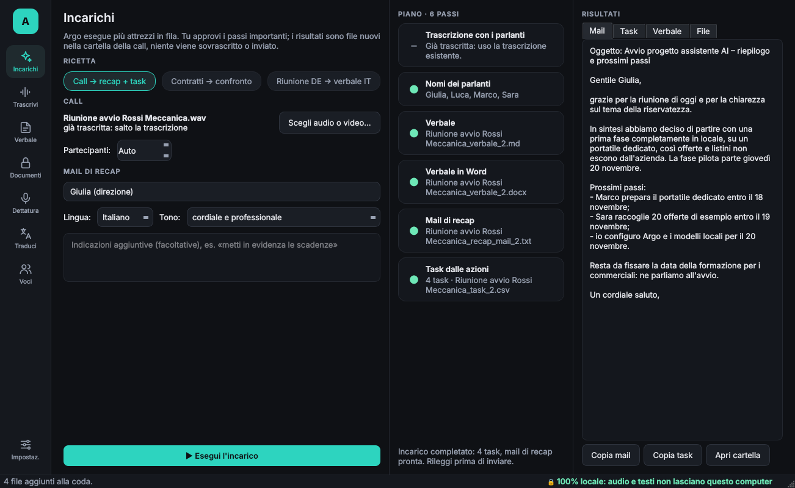
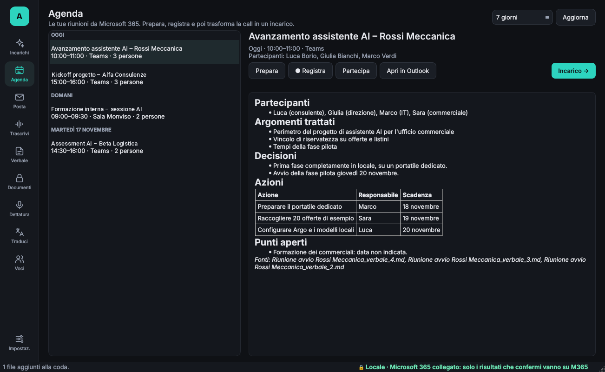

# Manuale di Argo · Cassetta degli attrezzi AI

*Versione del manuale: 20261115.1415 · riferita all'app versione 20261115.1415*

Argo è una cassetta degli attrezzi di intelligenza artificiale che lavora **tutta sul tuo computer**. Contiene cinque attrezzi:

- **Trascrittore**: trascrive riunioni e riconosce chi parla.
- **Verbale**: trasforma una trascrizione in un verbale.
- **Documenti riservati**: risponde a domande su documenti riservati.
- **Dettatura**: trasforma la tua voce in testo già scritto bene.
- **Traduzione**: traduce rispettando il glossario aziendale.

Audio, documenti e testi non vengono mai inviati a servizi cloud.

---

## Indice

1. [Come è fatta Argo](#1-come-è-fatta-argo)
2. [Requisiti](#2-requisiti)
3. [Installazione](#3-installazione)
4. [Primo avvio e configurazione](#4-primo-avvio-e-configurazione) · [L'interfaccia](#4bis-linterfaccia)
5. [Trascrittore](#5-trascrittore) · [Incarichi](#5bis-incarichi) · [Agenda](#5ter-agenda) · [Posta AI](#5quater-posta-ai)
6. [Anagrafe voci](#6-anagrafe-voci)
7. [Verbale](#7-verbale)
8. [Documenti riservati](#8-documenti-riservati)
9. [Dettatura](#9-dettatura)
10. [Traduzione con glossario](#10-traduzione-con-glossario)
11. [Impostazioni nel dettaglio](#11-impostazioni-nel-dettaglio) · [I documenti Word](#11bis-i-documenti-word)
12. [Dove stanno i dati](#12-dove-stanno-i-dati)
13. [Uso da riga di comando](#13-uso-da-riga-di-comando)
14. [Aggiornare e disinstallare](#14-aggiornare-e-disinstallare)
15. [Risoluzione dei problemi](#15-risoluzione-dei-problemi)
16. [Privacy, GDPR e AI Act](#16-privacy-gdpr-e-ai-act)
17. [Domande frequenti](#17-domande-frequenti)

---

## 1. Come è fatta Argo

Argo usa due "motori", entrambi locali.

| Motore | Cosa fa | Usato da |
| --- | --- | --- |
| **WhisperX + pyannote** (dentro Argo) | Trascrizione parlato → testo, allineamento parola per parola, separazione dei parlanti, impronte vocali | Trascrittore, Anagrafe voci |
| **faster-whisper** (dentro Argo) | Trascrizione semplice, senza parlanti | Dettatura, Traduzione (da audio) |
| **Ollama** (programma a parte) | Modello linguistico (LLM) che scrive e ragiona sui testi, più un modello di *embedding* per cercare nei documenti | Verbale, Documenti riservati, Dettatura, Traduzione |

**Quando serve Internet:**

- per installare i pacchetti;
- per scaricare i modelli la prima volta (WhisperX/pyannote da Hugging Face, LLM da Ollama).

Dopo l'installazione il lavoro avviene offline.

La barra in basso nella finestra mostra **🔒 100% locale** finché Ollama punta a questo computer (`localhost`). Se nelle impostazioni indichi un server Ollama su un'altra macchina, il badge te lo segnala.

---

## 2. Requisiti

### Sistemi supportati

| Sistema | Supporto | Note |
| --- | --- | --- |
| Windows 10/11 x64 | Sì | GPU NVIDIA facoltativa |
| Windows 11 ARM (es. Snapdragon) | Sì | Gira in emulazione x64: più lento, consigliato `large-v3-turbo` |
| macOS Apple Silicon (M1 e successivi) | Sì | Homebrew non serve (se c'è, viene usato) |
| macOS Intel | No | PyTorch non pubblica più versioni per Mac Intel |
| Linux | Non ancora | Il codice Python è portabile, ma manca l'installer |

### Spazio e memoria

- **Disco:** circa 10 GB per Python, librerie e modelli di trascrizione. Ogni modello Ollama occupa da qualche GB in su (per esempio `gemma3:12b` circa 8 GB).
- **RAM:** per il modello linguistico conta la memoria. Con 16 GB sono adatti modelli intorno ai 12-14 miliardi di parametri. Con meno memoria scegli modelli più piccoli.

### Account

- Un account gratuito [Hugging Face](https://huggingface.co), che serve solo per scaricare il modello di separazione dei parlanti.

---

## 3. Installazione

### 3.1 Token Hugging Face (una volta sola)

1. Accedi a Hugging Face.
2. Apri la pagina del modello [pyannote/speaker-diarization-community-1](https://huggingface.co/pyannote/speaker-diarization-community-1) e accetta le condizioni d'uso.
3. Vai su [huggingface.co/settings/tokens](https://huggingface.co/settings/tokens) → **Create new token** → tipo **Read** → copia il token (inizia con `hf_`).

> Tratta il token come una password: non incollarlo in chat, email o documenti condivisi. Se lo esponi per errore, revocalo e creane uno nuovo.

### 3.2 Scarica Argo

Da [github.com/Argo-s-new-dreams/argo-ai](https://github.com/Argo-s-new-dreams/argo-ai): **Code → Download ZIP**, poi estrai lo ZIP in una cartella qualsiasi (per esempio *Download*).

### 3.3 Avvia l'installer

**Windows**

1. Doppio clic su `Installa-Argo.bat`.
2. Se compare SmartScreen: *Ulteriori informazioni → Esegui comunque*.
3. L'installer:
   - sblocca i file scaricati;
   - installa `uv` e `ffmpeg` con winget se mancano;
   - crea l'ambiente Python 3.12 x64 in `%USERPROFILE%\whisperx-env`;
   - installa le librerie;
   - crea il collegamento **Argo AI** sul Desktop e nel menu Start.

**macOS (Apple Silicon)**

1. Tasto destro su `Installa-Argo.command` → **Apri**. Se macOS lo blocca: *Impostazioni di Sistema → Privacy e sicurezza → Apri comunque*.
2. L'installer:
   - prepara `uv` e `ffmpeg`: se c'è [Homebrew](https://brew.sh) usa quello, altrimenti scarica `uv` dal sito ufficiale (astral.sh) e prende `ffmpeg` dal pacchetto Python `imageio-ffmpeg`, dentro la cartella di Argo. Non servono password di amministratore;
   - crea l'ambiente in `~/whisperx-env`;
   - installa le librerie;
   - crea l'app **Argo AI** in `~/Applications`.

Gli installer non sono firmati digitalmente, per questo i sistemi mostrano un avviso. Il codice è tutto leggibile nel repository.

> Se hai una versione precedente chiamata "Trascrittore", l'installer la sostituisce. Voci, impostazioni e coda restano dove sono.

### 3.4 Installa Ollama (per Verbale, Documenti, Dettatura, Traduzione)

1. Scarica Ollama da [ollama.com](https://ollama.com) e avvialo.
2. Scarica almeno un modello per i testi e uno per gli embedding. Per esempio, da Terminale o PowerShell:

```bash
ollama pull gemma3:12b   # testi, circa 8 GB: adatto a 16 GB di RAM
ollama pull bge-m3       # embedding multilingue per i documenti
```

I modelli si possono scaricare anche dall'app (vedi [§11.4](#114-modello-linguistico-locale-ollama)).

Senza Ollama il Trascrittore e l'Anagrafe voci funzionano lo stesso. La Dettatura in modalità *Solo trascrizione* non ha bisogno di Ollama.

---

## 4. Primo avvio e configurazione

1. Apri **Argo AI**. Al primo avvio un messaggio ti ricorda di inserire il token.
2. Scheda **Impostazioni** → incolla il token in *Hugging Face* → **Salva e verifica**. Argo controlla il token sul sito di Hugging Face e ti dice se:
   - va bene;
   - è sbagliato o scaduto;
   - non hai ancora accettato le condizioni del modello.
3. In *Trascrizione* scegli modello e lingua (per cominciare: `large-v3-turbo`, Italiano) → **Salva impostazioni**.
4. In *Modello linguistico locale* premi **Verifica e aggiorna elenco**, scegli il modello per i testi e quello per gli embedding → **Salva modelli**.

**Per una prova veloce senza materiale tuo:** la cartella `app/esempi` contiene una riunione, un NDA e un capitolato, tutti **fittizi**. I pulsanti *Usa l'esempio* ed *Esempio* li caricano.

---

## 4bis. L'interfaccia

- **Menu laterale a icone:** Incarichi, Trascrivi, Verbale, Documenti, Dettatura, Traduci, Voci e, in fondo, Impostazioni. Passando il mouse su un'icona compare il nome completo.
- **Tema:** scuro (predefinito), chiaro, oppure come il sistema. Si sceglie in *Impostazioni → Aspetto* e cambia subito, senza riavviare.
- **Bollino in basso a destra:** *100% locale* finché il modello linguistico gira su questo computer. Se punti Ollama a un'altra macchina, il bollino lo segnala.


---

## 5. Trascrittore

La scheda principale. A sinistra c'è la **coda** di file audio o video da trascrivere; a destra il **dettaglio** del file selezionato:
- le **corsie dei parlanti**, una per persona, colorate, che mostrano quando parla ciascuno lungo la registrazione;
- la **trascrizione** con i nomi colorati allo stesso modo;
- i pulsanti *Nomi dei parlanti*, *Marca voci*, *Apri testo*, *Word* e *Verbale →*.

Le stesse azioni sono anche nel menu col **tasto destro** sulle righe della coda.

### 5.1 Formati accettati

Audio: `wav`, `mp3`, `m4a`, `aac`, `flac`, `ogg`, `opus`, `wma`.
Video: `mp4`, `mov`, `mkv`, `webm`, `m4v`, `avi`, `wmv`: per esempio le registrazioni delle call di Teams o Zoom. Argo ne usa solo l'audio; il file video resta dov'è e non viene modificato.

### 5.2 Aggiungere file

- Trascina file o intere cartelle nella finestra, oppure usa **➕ Aggiungi file…**.
- Nella colonna **Partecipanti** indica quante persone parlano. Se il numero è giusto, la separazione delle voci migliora molto. Con `0` decide il modello.

### 5.3 Avviare e seguire il lavoro

- **▶ Avvia coda** elabora uno dopo l'altro tutti i file *In attesa*.
- La colonna **Avanzamento** mostra le tre fasi: *Trascrizione*, *Allineamento*, *Riconoscimento parlanti*.
- Stati possibili:

| Stato | Significato |
| --- | --- |
| In attesa | Pronto da elaborare |
| In corso | In lavorazione |
| Completata | Trascrizione pronta |
| Errore | Qualcosa è andato storto: guarda il log in basso |
| Interrotta | Fermata da te o dalla chiusura dell'app |

- La coda viene salvata: se chiudi Argo, la ritrovi alla riapertura.
- **Tasto destro** su una riga apre un menu con tutte le azioni: trascrizione, nomi, Word, verbale, Marca voci, rimetti in coda, cartella, rimuovi. **Canc** (o ⌫ sul Mac) rimuove le righe selezionate.
- **■ Ferma coda** interrompe il file in lavorazione e chiude tutti i processi di WhisperX. Se premi subito di nuovo *Avvia*, Argo può chiederti di attendere qualche secondo che la chiusura finisca.
- **Rimetti in coda** riporta in *In attesa* un file con errore o interrotto. Su una trascrizione completata ti chiede se rifare **solo i parlanti** o **tutta la trascrizione**. **Rimuovi** toglie il file dalla lista senza cancellarlo.

### 5.3bis Cambiare il numero di partecipanti dopo la trascrizione

Se la separazione delle voci non torna (per esempio ha trovato 2 persone ma erano 3), cambia il numero nella colonna **Partecipanti** anche su una riga *Completata*. Argo chiede conferma e **rifà solo la separazione dei parlanti**: il testo trascritto resta lo stesso, e ci vuole molto meno di una trascrizione completa. Alla fine la riga torna *Completata* con i nuovi parlanti; i nomi corretti a mano vanno riassegnati.

> La prima trascrizione scarica i modelli (alcuni GB): è normale che ci metta di più.

### 5.4 Risultati

Accanto al file audio Argo salva:

- `nomefile.json`: il risultato completo di WhisperX, con le impronte vocali dei parlanti;
- `nomefile_nomi.txt`: la trascrizione leggibile, con orario e nome.

```
[00:00:12] Luca: Partiamo dal primo punto...

[00:00:41] Marco: Ok, sul budget però...
```

I parlanti non riconosciuti compaiono come **Sconosciuto 1**, **Sconosciuto 2** e così via.

Pulsanti disponibili sulla riga selezionata:

- **Apri trascrizione**: apre il file `_nomi.txt`.
- **✏️ Nomi dei parlanti…** (oppure doppio clic sulla riga completata): apre la revisione dei nomi (vedi sotto).
- **Apri cartella**: apre la cartella del file.
- **Esporta in Word**: crea `nomefile_trascrizione.docx`, con orari in grigio e nomi dei parlanti in grassetto, e lo apre.
- **Crea verbale →**: passa la trascrizione alla scheda Verbale.

### 5.5 Nomi dei parlanti (revisione)

La finestra mostra, per ogni voce trovata:

- l'etichetta del modello (`SPEAKER_00`…);
- quanto tempo ha parlato;
- la somiglianza con la voce dell'anagrafe più vicina;
- il nome assegnato.

1. Passa il mouse su un nome per leggere una frase di quel parlante e capire chi è.
2. Correggi il nome dal menu a tendina, oppure scrivine uno nuovo.
3. Spunta **Memorizza** per salvare l'impronta di quella voce nell'anagrafe: dalla volta successiva verrà riconosciuta da sola.
4. Conferma con **Applica e salva**: Argo riscrive il `_nomi.txt` con i nomi corretti.

I nomi scelti restano **salvati** (dentro il file `.json` della trascrizione): riaprendo la finestra li ritrovi, e li puoi correggere quante volte vuoi. Le etichette lasciate come *Sconosciuto* invece vengono ricalcolate: se poi aggiungi quella voce all'anagrafe, alla riapertura la trovi già riconosciuta.

**Due etichette sono la stessa persona?** Dai loro lo stesso nome: nella trascrizione i loro interventi vengono uniti. **Mancano persone?** Cambia il numero di partecipanti (vedi §5.3bis).

### 5.6 Consigli per una buona trascrizione

- Registra vicino a chi parla. Un microfono da riunione o le registrazioni di Teams vanno bene.
- Imposta il numero esatto di partecipanti.
- In *Parole chiave* metti termini tecnici, nomi di aziende e nomi dei partecipanti: il modello li scrive meglio.
- Le voci sovrapposte restano il punto debole di qualsiasi sistema di separazione dei parlanti.

---

## 5bis. Incarichi

Gli **Incarichi** funzionano in stile *Cowork*: Argo esegue più attrezzi in fila al posto tuo. Tu vedi il piano, approvi i passi importanti e alla fine trovi i risultati nella cartella della call.



### La ricetta «Call → recap + task»

1. **Scegli audio o video** della call. Se è già stata trascritta (c'è il `.json` accanto), la trascrizione viene saltata.
2. Indica, se vuoi:
   - il numero di **partecipanti**;
   - i **destinatari** della mail;
   - la **lingua** della mail (italiano, inglese o tedesco) e il **tono**;
   - **indicazioni aggiuntive**, per esempio «metti in evidenza le scadenze».
3. Premi **▶ Esegui l'incarico**. Il piano ha sei passi:

| Passo | Cosa fa | Risultato nella cartella |
| --- | --- | --- |
| Trascrizione con i parlanti | Mette il file nella coda del Trascrittore e aspetta che finisca | `nome.json`, `nome_nomi.txt` |
| Nomi dei parlanti | **Si ferma e chiede conferma**: *Correggi nomi…* apre la revisione, *Conferma* va avanti | — |
| Verbale | Verbale con decisioni, azioni e punti aperti (anche per riunioni lunghe) | `nome_verbale.md` |
| Verbale in Word | Lo stesso verbale impaginato | `nome_verbale.docx` |
| Mail di recap | Bozza di mail con oggetto, sintesi e prossimi passi | `nome_recap_mail.txt` |
| Task dalle azioni | Elenco di cose da fare con responsabile e scadenza | `nome_task.csv`, `nome_task.json` |

4. A destra, in **Risultati**, trovi la mail (modificabile), la tabella dei task, il verbale e l'elenco dei file. Con **Copia mail** e **Copia task** li incolli in Outlook, Teams o Planner.

### Le regole di sicurezza

- **Niente viene sovrascritto:** se un file esiste già, Argo crea `_2`, `_3`…
- **Niente viene inviato:** la mail resta una bozza. Senza Microsoft 365 la copi; con Microsoft 365 collegato finisce nelle **Bozze** di Outlook e la invii tu.
- **Registro:** ogni incarico scrive `nome_incarico_registro.txt` con ora e passi eseguiti, utile per sapere cosa ha fatto l'AI e quando.
- **■ Ferma l'incarico** interrompe in qualsiasi momento; i file già creati restano.

Le ricette *Contratti → confronto* e *Riunione DE → verbale IT* sono indicate come «prossimamente».

### Con Microsoft 365 collegato (facoltativo)

Se colleghi il tuo account (vedi [§11.5](#115-microsoft-365-facoltativo)), l'incarico ha tre aiuti in più.

- **Dal calendario:** il pulsante accanto ai destinatari cerca nel tuo calendario la riunione più vicina all'ora della registrazione. Inserisce titolo e partecipanti con le email; togli chi non deve ricevere il recap.
- **Bozza in Outlook** (passo 7): Argo ti mostra a chi andrà la mail e **chiede conferma**. Con *Crea bozza* la trovi nelle **Bozze** di Outlook, con *Apri* per aprirla; non viene mai inviata da sola. Prima di confermare puoi modificare il testo nella scheda *Mail*.
- **Task in Planner** (passo 8):
  - scegli il piano dall'elenco dei tuoi piani; i task finiscono nel primo bucket, con la scadenza quando è chiara;
  - un task viene **assegnato** solo se il responsabile corrisponde senza ambiguità a un partecipante della riunione; gli altri restano da assegnare;
  - *Salta* lascia tutto com'è.

Su Microsoft 365 vanno solo **la bozza e i task che confermi**; Argo legge il calendario. Audio, trascrizioni e documenti restano sul computer.

---

## 5ter. Agenda

*Richiede Microsoft 365 collegato (sezione 11.5).*



L'Agenda mostra le tue riunioni da Microsoft 365, raggruppate per giorno: oggi e domani, 7 o 14 giorni. La riunione in corso è evidenziata e quelle passate sono in grigio. Selezionando una riunione vedi orario, luogo o Teams, partecipanti e testo dell'invito.

| Pulsante | Cosa fa |
| --- | --- |
| **Prepara** | Briefing **locale** in Markdown: obiettivo probabile, partecipanti, cosa è emerso nelle riunioni precedenti, azioni aperte, tre domande utili. Argo cerca fino a 3 verbali recenti (`*_verbale*.md`) che citano i partecipanti, nelle cartelle dei file in coda e in quella delle registrazioni, e li elenca come *Fonti* in fondo. |
| **● Registra** | Registra dal microfono in un WAV (16 kHz, mono) nella cartella delle registrazioni (predefinita `Documenti/Argo/Registrazioni`), con nome `data ora oggetto.wav`. Avvisa se non sente audio. Premi di nuovo per fermare. |
| **Partecipa** | Apre il link Teams della riunione. |
| **Apri in Outlook** | Apre l'evento in Outlook sul web. |
| **Incarico →** | Passa agli Incarichi con i destinatari del recap già compilati dai partecipanti e, se hai appena registrato, con la registrazione già scelta. |

Il flusso tipico: **Prepara** prima della call, **Registra** durante, **Incarico →** subito dopo per verbale, recap e task.

> Sul Mac, la prima volta macOS chiede il permesso al microfono. Se l'hai negato: *Impostazioni di Sistema → Privacy e sicurezza → Microfono → Argo AI*. Registra la tua voce nella stanza: per una call Teams in cuffia registri solo te stesso, quindi è meglio usare la registrazione di Teams e passarla agli Incarichi.

## 5quater. Posta AI

*Richiede Microsoft 365 collegato e la lettura della posta attivata (sezione 11.5).*


Non è un client di posta completo: è un **assistente** accanto a Outlook. Mostra le mail **non lette** o le ultime 40 della posta in arrivo; per ciascuna vedi mittente, ora, importanza (!) e allegati (📎).

| Pulsante | Cosa fa |
| --- | --- |
| **Riassumi** | 3-6 punti sulla conversazione intera (ultimi 6 messaggi del thread). |
| **Cosa mi si chiede** | Una riga per ogni richiesta rivolta a te, con scadenza se c'è. |
| **Scrivi risposta** | Bozza nella lingua della mail, col tono scelto e con le tue indicazioni (es. «accetto, propongo giovedì alle 10»). Il testo è modificabile. |
| **Salva come bozza in Outlook** | Crea la risposta, o *Rispondi a tutti*, nelle **Bozze** di Outlook, con la mail originale citata. **Non la invia**: la rileggi e la invii tu da Outlook. |
| **Crea task in Planner** | Estrae le richieste come task, ti mostra l'elenco e ti fa scegliere il piano. I task non vengono assegnati ad altri. |
| **Segna come letta** · **Apri in Outlook** | Come in Outlook. Gli allegati si aprono in Outlook. |

**Privacy:** il testo delle mail arriva dal tuo tenant Microsoft 365 al tuo computer e viene elaborato dal **modello locale** (Ollama). Non passa da nessun servizio AI esterno e Argo non conserva le mail su disco. La lettura è **disattivata** finché non la attivi.

## 6. Anagrafe voci

L'anagrafe contiene un'**impronta vocale** (un vettore numerico) per ogni persona. Più campioni ha una persona, più il riconoscimento è stabile: Argo ne fa la media.

### Aggiungere una voce

Ci sono tre modi per creare un'impronta.

**🎙 Registra voce… (dal microfono)**

1. Scrivi o scegli il nome. Se la voce esiste già, la registrazione diventa un nuovo campione.
2. Premi **● Registra** e fai parlare **solo** quella persona, nel silenzio. Può leggere il testo proposto nella finestra.
3. La barra mostra il livello del microfono e i secondi registrati. Servono almeno 10 secondi; dai 20 in su l'impronta è più stabile. Se non arriva audio, la finestra lo segnala.
4. Premi **■ Stop**, se vuoi **▶ Riascolta**, poi spunta il **consenso** e premi **Crea impronta**.

Sul Mac, alla prima registrazione il sistema chiede il permesso di usare il microfono.

**🎧 Marca voci in un audio… (da una registrazione)**

Serve quando hai una riunione o un'intervista in cui parlano più persone e vuoi ricavare le impronte di tutte in una volta. Si apre anche dal Trascrittore, con **🎧 Marca voci…** sulla riga selezionata.

1. **Apri audio o video…**: compare la forma d'onda. La linea rossa è la posizione di ascolto.
   Se è un **video** (per esempio la registrazione di una call di Teams), sopra la forma d'onda vedi anche il video, sincronizzato con l'ascolto: è il modo più semplice per capire chi sta parlando, perché nelle call il nome compare sul riquadro di chi parla. Puoi allargare il riquadro del video trascinando il bordo tra video e forma d'onda.
2. Ascolta con **▶ Ascolta**, **⏪ 5 s** e **5 s ⏩**. Clicca sulla forma d'onda per saltare in un punto.
3. **Zoom:** rotella del mouse (o i pulsanti *Zoom +* e *Zoom −*); con **Maiusc + rotella** scorri. *Tutto* torna alla vista completa.
4. **Trascina** sulla forma d'onda per selezionare un tratto in cui parla una sola persona. **▶ Ascolta selezione** lo riproduce.
5. Scrivi o scegli la **Persona** e premi **✚ Assegna selezione**. Il tratto si colora e finisce nella tabella; puoi marcare più tratti per la stessa persona.
6. Il riepilogo mostra i secondi per persona: 🔴 sotto 10 s, 🟡 sufficiente, ✅ 20 s o più. Doppio clic su una riga della tabella per riascoltarla; **Rimuovi segno** la toglie.
7. Spunta il **consenso** e premi **Crea impronte**: Argo ritaglia i tratti, li unisce per persona e calcola un'impronta per ciascuno, uno dopo l'altro.

**Se l'audio è già stato trascritto** (c'è il file `.json` accanto all'audio), sotto la forma d'onda compare una corsia con i **parlanti rilevati**. Dove li riconosce, mostra già il nome dall'anagrafe.

- Clicca su un tratto della corsia per selezionarlo.
- Oppure scegli il parlante in **Parlante rilevato** e premi **Assegna tutti i suoi tratti**: tutti i suoi interventi vanno alla persona indicata.

Prima di creare l'impronta conviene ascoltarne qualche tratto: la separazione automatica a volte mescola due voci.

**➕ Nuova voce da audio… (da un file)**

- **➕ Nuova voce da audio…**: scegli un file in cui parla **solo** quella persona (bastano 20-60 secondi puliti) e dai un nome. Usa solo lettere, numeri, spazi, `-` e `_`.
- **Aggiungi campione…**: aggiunge un altro audio a una voce esistente, utile se la riconosce male.
- In alternativa, il modo più comodo: trascrivi una riunione, apri **✏️ Nomi dei parlanti…** e spunta **Memorizza**.

### Gestire le voci

- **Rinomina…** cambia il nome di una voce.
- **Elimina** cancella la voce e tutti i suoi campioni. Viene chiesta conferma.

### La soglia di somiglianza

In *Impostazioni → Riconoscimento voci* trovi la **Somiglianza minima** (da 0,20 a 0,95, predefinita 0,50):

- **più alta**: meno nomi sbagliati, ma più "Sconosciuto";
- **più bassa**: riconosce di più, ma rischia di scambiare persone con voci simili.

Comincia da 0,50 e regola in base a quello che vedi nella revisione: la colonna *Somiglianza* ti dice quanto erano sicuri gli abbinamenti.

> Prima di registrare la voce di qualcuno chiedi il suo consenso: vedi [§16](#16-privacy-gdpr-e-ai-act).

---

## 7. Verbale

Trasforma una trascrizione con i nomi in un testo pronto da usare. Richiede un modello per i testi in Ollama.

1. Carica la trascrizione in uno di questi modi:
   - **Apri trascrizione…** (file `.txt` o `.md`);
   - incollala nel riquadro di sinistra;
   - premi **Crea verbale →** dal Trascrittore;
   - premi **Usa l'esempio**.
2. Scegli il **Formato**:

| Formato | Risultato |
| --- | --- |
| Verbale della riunione | Markdown con *Partecipanti, Argomenti trattati, Decisioni, Azioni* (tabella Azione/Responsabile/Scadenza), *Punti aperti* |
| Mail di sintesi al cliente | Mail cordiale e professionale, massimo 250 parole circa |
| Solo elenco delle azioni | Solo la tabella delle azioni |

3. Premi **▶ Genera**: il testo compare parola per parola. Premi di nuovo il pulsante per fermare la generazione.
4. **Copia**, **Salva .md** oppure **Salva Word**. I nomi proposti stanno accanto alla trascrizione: `nomefile_verbale`, `nomefile_sintesi` o `nomefile_azioni`, a seconda del formato.

**Come lavora:**

- Al modello viene chiesto di usare *solo* le informazioni della trascrizione e di scrivere "non indicato" quando un dato manca.
- Le riunioni lunghe vengono divise in parti: Argo estrae gli appunti da ciascuna e poi li unisce nel risultato finale.

> Un LLM può comunque sbagliare o fraintendere. **Rileggi sempre il verbale** prima di inviarlo, soprattutto nomi, date e responsabilità.

---

## 8. Documenti riservati

Fai domande su contratti, NDA e capitolati senza caricarli nel cloud. Richiede in Ollama sia il modello per i testi sia quello di embedding.

### Indicizzare

- **➕ Aggiungi…** accetta file `pdf`, `docx`, `txt` e `md`.
- Argo:
  1. estrae il testo pagina per pagina;
  2. lo divide in estratti di circa 1.200 caratteri, parzialmente sovrapposti;
  3. calcola gli embedding con il modello scelto;
  4. salva l'indice nella cartella dati.
- **Esempio** carica i due documenti fittizi. **Svuota** cancella l'indice: i file originali non vengono toccati.
- I PDF scansionati (solo immagini, senza testo selezionabile) non vengono letti: Argo non fa OCR.
- Se cambi il modello di embedding, Argo svuota l'indice e lo ricostruisce: vettori calcolati con modelli diversi non sono confrontabili.

### Salvare in Word

**Salva Word**, accanto a *Fonti usate per la risposta*, crea un documento con la domanda, la risposta e l'elenco delle fonti (file, pagina e inizio dell'estratto).

### Chiedere

1. Scrivi la domanda (es. *"Qual è la durata dell'obbligo di riservatezza? Ci sono penali?"*) e premi **Chiedi**.
2. Argo trova i 5 estratti più pertinenti e li passa al modello.
3. Il modello risponde citando le fonti con **[1]**, **[2]**… Se i documenti non contengono la risposta, deve dirlo chiaramente.
4. Nel riquadro **Fonti usate per la risposta** vedi, per ogni citazione:
   - il nome del file e la pagina;
   - il grado di somiglianza;
   - l'inizio dell'estratto.

   Usale per controllare la risposta sul documento originale.

> Le risposte sono un aiuto alla lettura, non un parere legale.

---

## 9. Dettatura

Parli e ottieni un testo già scritto bene.

1. Scegli il **Formato**:
   - Mail professionale;
   - Mail informale;
   - Appunto ordinato;
   - Messaggio breve (Teams/WhatsApp);
   - Solo trascrizione (non serve Ollama).
2. Premi **● Registra**, parla, poi **■ Stop**. In alternativa usa **Da file audio…**, che accetta anche video (mp4, mov…).
3. A sinistra compare la trascrizione grezza, a destra il testo riscritto. Puoi correggere la trascrizione e premere **Riscrivi**, oppure cambiare formato e riscrivere.
4. **Copia risultato** e incolla dove ti serve, oppure **Salva Word**.

**Dettagli tecnici:**

- La dettatura usa faster-whisper (modello *Trascrizione rapida*, predefinito `large-v3-turbo`) senza separazione dei parlanti ed è impostata sull'italiano.
- La registrazione temporanea viene salvata come `argo_dettatura.wav` nella cartella temporanea del sistema.
- Il modello di riscrittura ha l'istruzione di non aggiungere fatti che non hai detto.

**Microfono:**

- **macOS:** alla prima registrazione il sistema chiede il permesso. Se l'hai negato, riattivalo da *Impostazioni di Sistema → Privacy e sicurezza → Microfono*.
- **Windows:** *Impostazioni → Privacy e sicurezza → Microfono*, con l'accesso per le app desktop attivo.

---

## 10. Traduzione con glossario

Traduce testi e trascrizioni in **inglese, tedesco o italiano** imponendo al modello la terminologia aziendale.

### Tradurre

1. Inserisci il testo in uno di questi modi:
   - incollalo nel riquadro;
   - **Apri testo…** (`.txt` o `.md`);
   - **Trascrivi audio…**, che trascrive un audio in lingua rilevata automaticamente.
2. Scegli **Traduci in:** e premi **▶ Traduci**.
3. Argo cerca nel testo i termini del glossario e li passa al modello come **glossario obbligatorio**. La barra di stato mostra quanti termini ha applicato.
4. Orari, nomi e formato delle righe `[ora] Nome: testo` vengono mantenuti: puoi tradurre direttamente un `_nomi.txt`.

I testi lunghi vengono tradotti a blocchi di circa 4.000 caratteri. **Salva Word** salva la traduzione in un documento (`traduzione_en.docx`, `traduzione_de.docx`…).

### Il glossario

- La tabella ha tre colonne: **it**, **en**, **de**. Ogni riga è un termine con le sue traduzioni.
- **+ Riga** e **− Riga** aggiungono e tolgono termini. Le celle si modificano direttamente.
- **Importa CSV…** accetta file con separatore `;` o `,`. Una riga d'intestazione `it;en;de` è facoltativa e viene ignorata.
- **Salva glossario** scrive `glossario.csv` nella cartella dati. Senza salvataggio le modifiche si perdono alla chiusura.

Esempio di CSV:

```
it;en;de
offerta;quotation;Angebot
ordine di acquisto;purchase order;Bestellung
```

> Il glossario guida il modello, ma non è una garanzia assoluta. Per testi contrattuali o tecnici critici fai rivedere la traduzione da una persona.

---

## 11. Impostazioni nel dettaglio

La scheda è scorrevole: le sezioni sono quattro.

### 11.1 Hugging Face

Contiene il token, il pulsante **Mostra** e **Salva e verifica**, più i link alle due pagine necessarie (condizioni del modello e creazione del token). Il token serve solo per scaricare i modelli.

### 11.2 Trascrizione

| Voce | Opzioni | Consiglio |
| --- | --- | --- |
| Modello | `large-v3` (massima qualità, lento), `large-v3-turbo` (ottimo compromesso), `medium`, `small` | `large-v3-turbo` per l'uso quotidiano |
| Lingua | Italiano, Inglese, Tedesco, Francese, Spagnolo, Rilevamento automatico | Indica la lingua se la conosci: è più affidabile |
| Calcolo su | CPU, GPU NVIDIA (CUDA) | Scegli GPU solo se hai una scheda NVIDIA con CUDA |
| Parole chiave | Testo libero | Nomi propri, sigle, termini di settore |

### 11.3 Riconoscimento voci

**Somiglianza minima**: vedi [§6](#6-anagrafe-voci).

### 11.3bis Aspetto

**Tema:** Scuro, Chiaro o Come il sistema. Il cambio è immediato.

### 11.4 Modello linguistico locale (Ollama)

- **Indirizzo Ollama:** predefinito `http://localhost:11434`.
- **Verifica e aggiorna elenco:** legge i modelli installati in Ollama.
- **Modello per testi:** usato da Verbale, Documenti, Dettatura e Traduzione.
- **Modello per documenti:** il modello di embedding usato dalla ricerca nei documenti, ad esempio `bge-m3`.
- **Trascrizione rapida:** il modello faster-whisper usato da Dettatura e Traduzione da audio (predefinito `large-v3-turbo`).
- **Scarica un modello:** scrivi il nome di un modello (es. `bge-m3`), premi **Scarica** e Argo lo scarica tramite Ollama, mostrando l'avanzamento.
- **Salva modelli:** memorizza le scelte.

**Scelta automatica.** Se non hai ancora scelto un modello, o quello scelto non è più installato, Argo ne sceglie uno da solo fra quelli presenti in Ollama e te lo segnala. Per i testi preferisce `gemma3`, poi `qwen3`, `llama3`, `mistral`, `phi`; per i documenti preferisce `bge-m3`. Puoi sempre cambiare la scelta qui.

Se il modello "ragiona" ad alta voce (per esempio `qwen3`), Argo nasconde automaticamente le parti `<think>…</think>`.

Per salvare tutto premi **Salva impostazioni**. **Apri cartella dati** apre la cartella descritta qui sotto.


### 11.5 Microsoft 365 (facoltativo)

Serve ad Agenda, Posta AI e Incarichi: calendario, posta, bozze di Outlook e Planner.

1. Un amministratore registra l'app in **Microsoft Entra ID** (una volta per organizzazione):
   - *App registrations → New registration*, nome **Argo AI**, solo questa organizzazione;
   - *Authentication → Add a platform → Mobile and desktop applications* con il redirect URI **`http://localhost`** (scritto così, senza porta). *Allow public client flows* può restare **No**: Argo non usa il codice dispositivo, spesso bloccato dai criteri di accesso condizionale;
   - *API permissions → Microsoft Graph → Delegated*: `Calendars.Read`, `Mail.ReadWrite`, `Tasks.ReadWrite`, `User.ReadBasic.All`, `Group.Read.All`, poi *Grant admin consent*.
2. In *Impostazioni → Microsoft 365* inserisci **Client ID** e **Tenant ID** dell'app e premi **Collega**.
3. Si apre il **browser** sulla pagina di accesso Microsoft: accedi con il tuo account e accetta i permessi. Quando compare «Argo è collegato a Microsoft 365» puoi chiudere la scheda. Hai 5 minuti.
4. Lo stato diventa *Collegato come …* e il bollino in basso diventa *Locale · Microsoft 365 collegato*.

5. Per **Posta AI** spunta *Leggi la posta per «Posta AI»*. Senza la spunta Argo non legge la posta, anche se il permesso `Mail.ReadWrite` è concesso (serve comunque per le bozze).

Il token di accesso resta in `whisperx-env/m365_token.bin`, leggibile solo dal tuo utente. **Scollega** lo cancella.

Se usavi già Argo con Microsoft 365 non servono nuovi permessi: Agenda e Posta AI usano gli stessi.

---

## 11bis. I documenti Word

Tutti gli attrezzi possono salvare il risultato in **Word (.docx)**. Argo chiede dove salvarlo e poi lo apre.

- **Cosa diventa cosa:** i titoli diventano titoli di Word, gli elenchi diventano elenchi puntati o numerati, le tabelle del verbale diventano tabelle vere con l'intestazione colorata. Grassetto e corsivo vengono mantenuti.
- **In ogni documento** ci sono un titolo, la data, un piè di pagina "Argo · AI locale" con data e ora, e una breve nota in fondo che ricorda che il testo è generato da un'AI e va riletto.
- **Tutto in locale:** il file viene creato con la libreria python-docx, senza servizi esterni. Non serve avere Word installato per crearlo; serve solo per aprirlo.

Il documento è un normale file Word: modificalo, cambia lo stile o togli la nota finale se non ti serve.

---

## 12. Dove stanno i dati

Tutto sta nella cartella `whisperx-env` dentro la tua cartella utente:

- Windows: `C:\Users\<nome>\whisperx-env`
- macOS: `/Users/<nome>/whisperx-env`

Puoi spostarla impostando la variabile d'ambiente `TRASCRITTORE_HOME`.

| Elemento | Contenuto |
| --- | --- |
| `app/` | Il programma |
| `voci/<Nome>/campione_N.npy` | Impronte vocali (dati biometrici) |
| `.hf_token` | Il token Hugging Face |
| `trascrittore_impostazioni.json` | Impostazioni |
| `trascrittore_coda.json` | La coda delle trascrizioni |
| `documenti_indice.json` + `.npy` | Indice dei Documenti riservati, con gli estratti dei testi |
| `glossario.csv` | Glossario di traduzione |

Trascrizioni e verbali vengono salvati **accanto ai file audio**, non in questa cartella. I modelli scaricati stanno nelle cache di Hugging Face e di Ollama.

**Backup:** copia `voci/`, `glossario.csv` e le impostazioni. L'indice dei documenti si può ricreare.

---

## 13. Uso da riga di comando

Il motore delle voci si può usare anche senza interfaccia. Usa il Python dell'ambiente di Argo:

- macOS: `~/whisperx-env/bin/python`
- Windows: `%USERPROFILE%\whisperx-env\Scripts\python.exe`

```bash
cd ~/whisperx-env/app

# registra una voce (campione audio di una sola persona); device facoltativo: cpu o cuda
~/whisperx-env/bin/python voci_core.py iscrivi Luca luca.wav

# elenco delle voci registrate
~/whisperx-env/bin/python voci_core.py elenco

# assegna i nomi a una trascrizione WhisperX già fatta con --diarize --speaker_embeddings
~/whisperx-env/bin/python voci_core.py identifica riunione.json
```

Per `iscrivi` il token Hugging Face deve essere già salvato (lo fa l'app).

---

## 14. Aggiornare e disinstallare

**Aggiornare dall'app (consigliato).** All'avvio Argo controlla su GitHub se c'è una versione nuova. Se la trova, ti mostra le novità e propone tre scelte: **Aggiorna ora**, **Più tardi**, **Apri GitHub**.

Con *Aggiorna ora* Argo:
1. scarica il pacchetto;
2. salva una copia della versione attuale in `whisperx-env/app_precedente`;
3. sostituisce solo i file del programma;
4. se la nuova versione chiede librerie nuove, le installa con `uv`;
5. alla fine ti propone di riavviarsi.

Voci, token, impostazioni, glossario e documenti indicizzati non vengono toccati.

In *Impostazioni → Aggiornamenti* trovi:
- la versione installata;
- **Controlla ora**;
- la casella per disattivare il controllo all'avvio.

Il controllo legge da GitHub solo il numero di versione e le novità: nessun dato viene inviato.

**Aggiornare a mano.** Scarica la nuova versione dal repository e rilancia l'installer. Il programma viene sostituito; voci, glossario, impostazioni e indice restano. Serve anche quando l'aggiornamento dall'app segnala che mancano librerie e non trova `uv`.

**Tornare indietro.** La versione precedente resta in `whisperx-env/app_precedente`: per ripristinarla, chiudi Argo e copia il contenuto di quella cartella in `whisperx-env/app`.

**Disinstallare:**

1. Elimina il collegamento **Argo AI** (Desktop e menu Start) oppure `~/Applications/Argo AI.app`.
2. Elimina la cartella `whisperx-env`. Attenzione: dentro ci sono anche le impronte vocali e il glossario, quindi fai prima un backup se ti servono.
3. Facoltativo: rimuovi i modelli da Ollama (`ollama rm <modello>`) e la cache di Hugging Face (`~/.cache/huggingface`).

---

## 15. Risoluzione dei problemi

| Sintomo | Causa probabile | Soluzione |
| --- | --- | --- |
| Errore **401** / token non valido | Token sbagliato, revocato o con spazi | Creane uno nuovo di tipo Read e premi **Salva e verifica** |
| Errore **403** / accesso negato al modello | Condizioni di pyannote non accettate | Accettale sulla pagina del modello con lo stesso account |
| "File … is not digitally signed" (Windows) | File scaricato bloccato da Windows | Usa `Installa-Argo.bat`, che sblocca i file prima di procedere |
| "Accesso negato" a `python.exe` durante l'installazione | Argo o un Python dell'ambiente è ancora aperto | Chiudi Argo e rilancia: l'installer prova comunque a fermarli |
| Download dei modelli interrotto (`IncompleteRead`) | Connessione instabile | Riavvia la coda: il download riprende |
| Avviso su **torchcodec** nel log | Innocuo: l'audio viene decodificato con ffmpeg | Nessuna azione |
| Tutti "Sconosciuto" | Anagrafe vuota o soglia troppo alta | Registra le voci; prova con soglia 0,45-0,50 |
| Persone scambiate tra loro | Soglia troppo bassa o campioni poco puliti | Alza la soglia; aggiungi campioni puliti |
| "Ollama non è acceso" | Ollama non è avviato o l'indirizzo è sbagliato | Avvia Ollama (icona del lama nella barra dei menu) e riprova |
| "Nessun modello scaricato" | Ollama è acceso ma vuoto | `ollama pull gemma3:12b` dal Terminale, oppure *Impostazioni → Scarica un modello* |
| "Manca il modello per i documenti" | Nessun modello di embedding | `ollama pull bge-m3` |
| Nessuna risposta dai Documenti | Indice vuoto o PDF scansionato | Indicizza documenti con testo selezionabile |
| Il microfono non registra | Permessi negati | Vedi [§9](#9-dettatura) |
| "Tratti troppo corti" in *Marca voci* | Meno di 10 secondi marcati per una persona | Marca altri tratti in cui parla solo lei |
| L'impronta da *Marca voci* riconosce male | Nei tratti ci sono voci sovrapposte o rumore | Elimina la voce, rimarca solo tratti puliti, aggiungi un campione con *Registra voce* |
| Trascrizione molto lenta | CPU, modello `large-v3`, PC ARM | Passa a `large-v3-turbo` o `medium`; su NVIDIA usa CUDA |
| Il Mac Intel non installa | Non supportato | Serve un Mac Apple Silicon o un PC Windows |
| Righe *Interrotta* che non si riescono a rimuovere o rimettere in coda (versioni fino alla 1910) | Un'elaborazione fermata restava agganciata alla coda | Chiudi e riapri Argo, poi aggiorna alla 1930 o successiva |
| Dopo «Aggiorna ora» Argo si chiude e non si riapre (fino alla 2000) | Il riavvio automatico non partiva sul Mac | Riapri *Argo AI* da Applicazioni: l'aggiornamento è già installato. Corretto dalla 2015 |
| Microsoft 365: «You don't have access to this», errore **53003** | Un criterio di accesso condizionale del tenant blocca l'accesso (per esempio il blocco del *device code flow*, usato fino alla 2015) | Aggiorna alla 2030, che accede dal browser; aggiungi il redirect `http://localhost` all'app. Se resta bloccato, in *Entra → Log di accesso → Accesso condizionale* trovi il criterio responsabile |
| Microsoft 365: errore **50011** | Manca il redirect URI | Aggiungi `http://localhost` in *Authentication → Mobile and desktop applications* |
| Posta AI dice «lettura della posta disattivata» | La spunta non è attiva | *Impostazioni → Microsoft 365 → Leggi la posta per «Posta AI»* |
| Agenda: «Impossibile registrare» | Permesso del microfono negato | *Impostazioni di Sistema → Privacy e sicurezza → Microfono → Argo AI* |
| "Controllo non riuscito" negli aggiornamenti | Nessuna connessione, oppure un firewall blocca GitHub | Riprova più tardi o aggiorna a mano dal pacchetto; puoi disattivare il controllo in *Impostazioni → Aggiornamenti* |
| "Homebrew non trovato" (versioni fino alla 1830) | L'installer vecchio richiedeva Homebrew | Usa l'installer dalla versione 1845 in poi: Homebrew non serve più |

Se un file va in **Errore**, il log in fondo alla scheda Trascrittore riporta il messaggio: è il primo posto dove guardare, e il testo da allegare a una segnalazione su GitHub.

---

## 16. Privacy, GDPR e AI Act

- **Tutto locale.** Audio e documenti non lasciano il computer. La telemetria anonima di pyannote è disattivata dall'app. L'unica connessione che Argo fa da sé è il controllo degli aggiornamenti su GitHub, che legge solo numero di versione e novità e si può disattivare in *Impostazioni → Aggiornamenti*.
- **Microsoft 365 è facoltativo:** se lo colleghi, Argo legge il calendario e scrive su Microsoft 365 solo la bozza della mail e i task che confermi, nel tuo tenant. Audio, trascrizioni e documenti non vengono inviati.
- **Informa sempre** i partecipanti che la riunione viene registrata e trascritta.
- **Le impronte vocali sono dati biometrici** (art. 9 GDPR). Registra le voci di altre persone solo con il loro consenso esplicito e cancellale quando non servono più (**Elimina** nell'Anagrafe).
- **Documenti riservati:** l'indice contiene estratti testuali dei documenti. Proteggi il computer (cifratura del disco, account con password) come faresti con gli originali.

### AI Act (Regolamento UE 2024/1689)

Riconoscere una persona confrontando la sua voce con un'anagrafe di impronte è **identificazione biometrica** (art. 3, punto 35).

- **Uso personale e non professionale:** gli obblighi per chi usa il sistema non si applicano (art. 2, par. 10).
- **Uso professionale** (riunioni di lavoro, clienti, colleghi): il riconoscimento dei partecipanti può rientrare tra i sistemi di identificazione biometrica remota ad alto rischio (Allegato III, punto 1(a)). I relativi obblighi si applicano dal 2 dicembre 2027, dopo l'Omnibus digitale. Valutalo con il tuo consulente prima di usarlo in azienda.
- **Da non aggiungere:** l'art. 5 vieta il riconoscimento delle emozioni sul luogo di lavoro e la categorizzazione biometrica su caratteristiche sensibili.
- **L'uso meno delicato** è la sola trascrizione con parlanti anonimi ("Sconosciuto 1, 2…"), senza anagrafe.
- I testi generati da Verbale, Dettatura e Traduzione sono prodotti da un'AI. Se li pubblichi o li condividi, valuta di dichiararlo (art. 50).

Queste note sono informative e non costituiscono consulenza legale.

---

## 17. Domande frequenti

**Serve una GPU?**
No. Su CPU funziona tutto, solo più lentamente. Sul Mac i modelli di Ollama sfruttano già la GPU Apple.

**Posso usare un modello Ollama diverso da quelli suggeriti?**
Sì, qualsiasi modello installato in Ollama. Modelli più grandi scrivono meglio ma richiedono più memoria e tempo.

**Posso usare le registrazioni video delle call (Teams, Zoom, Meet)?**
Sì. Trascrittore, Marca voci, Dettatura e Traduzione accettano anche file video come `mp4`, `mov`, `mkv` e `webm`: Argo ne estrae l'audio. In *Marca voci* il video si vede anche, così riconosci chi parla dal riquadro della call.

**Gli Incarichi inviano la mail al cliente?**
No, mai. Senza Microsoft 365 ottieni il testo da copiare; con Microsoft 365 collegato la trovi nelle Bozze di Outlook e la invii tu.

**Le trascrizioni restano anche se cancello la coda?**
Sì: i file `.json` e `_nomi.txt` stanno accanto agli audio. Rimuovere una riga dalla coda non cancella nulla.

**Posso riconoscere le voci in una riunione già trascritta senza rifarla?**
Sì. Dopo aver aggiunto nuove voci all'anagrafe, apri **✏️ Nomi dei parlanti…** sulla trascrizione: gli abbinamenti vengono ricalcolati dal file `.json`. In alternativa usa `voci_core.py identifica` (vedi [§13](#13-uso-da-riga-di-comando)).

**Il token Hugging Face viene usato durante le trascrizioni?**
Solo per scaricare o verificare i modelli. L'audio non viene mai inviato a Hugging Face.

**È un prodotto supportato?**
No. È un progetto personale open source (licenza MIT), fornito così com'è. Segnalazioni e suggerimenti sono benvenuti nelle [issue](https://github.com/Argo-s-new-dreams/argo-ai/issues).
